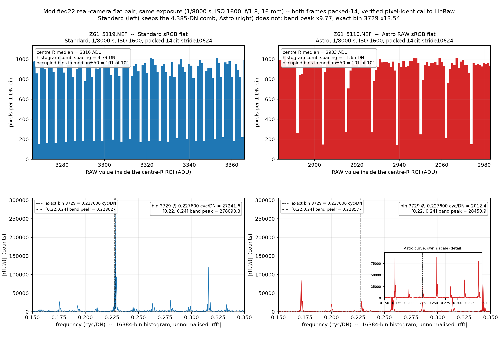
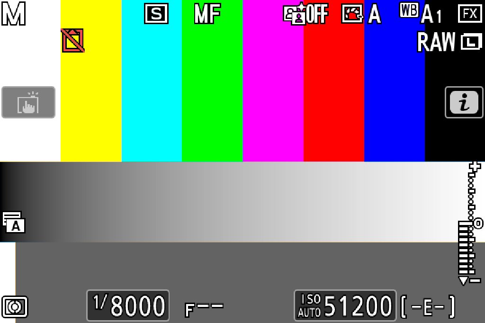
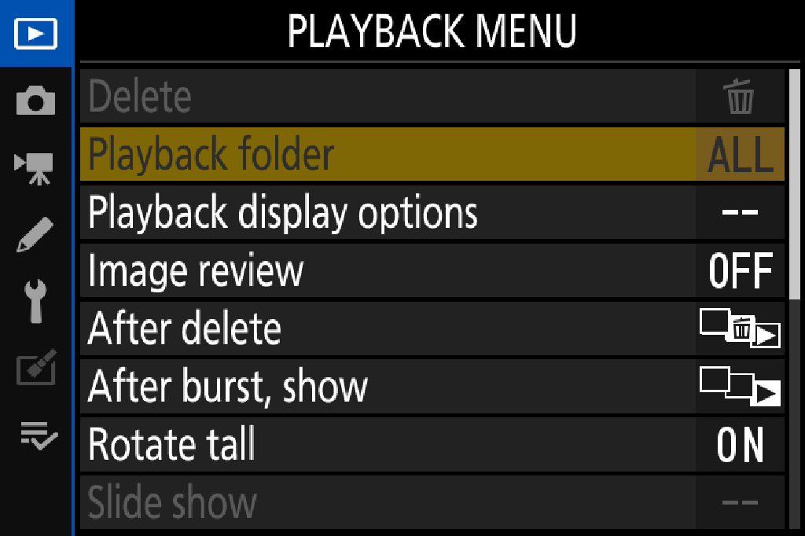

# Nikon Z6 C3.80 天文直通 RAW 与长曝光固件增强项目 (Nikon Z6 Astro Firmware)

> 🌐 **语言 / Language**: **简体中文** | **[English](README_EN.md)**

[](LICENSE)
[](https://downloadcenter.nikonimglib.com/en/download/fw/557.html)
[](https://github.com/sedirk/nikon-z-astro-firmware/releases/tag/v3.80-modified22)
本项目是针对 **尼康 Z6（固件版本 C3.80）** 的深度底层逆向工程与固件增强成果。通过对原厂数码相机图像流水线（ISP）、实时操作系统与菜单调度逻辑的精准重构，彻底解决了尼康初代微单长期困扰天文摄影与深空延时用户的三大核心痛点：**RAW 底层非线性暗角/增益梳状纹（同心彩圈）、暗电流与热噪点被激进邻域钳位（吃星/扣暗场失败）、以及扩展慢门（30秒以上）与间隔拍摄计时的严重限制**。

---

## 1. 核心解决问题一览 (Feature Matrix)

| 痛点与功能模块 | 官方原厂 C3.80 行为 | Modified22 增强行为 | 底层技术实现与证据 |
| :--- | :--- | :--- | :--- |
| **同心彩圈 / 增益梳状纹**<br>*(Concentric Colored Rings)* | 前端 ISP 强制对全尺寸 RAW 注入 $4.39\text{ DN}$ 周期数字增益与暗角调制，导致 RAW 直方图 R/B 通道周期性缺码（$0.2276\text{ cyc/DN}$ 尖峰），深空拉伸出现严重同心彩圈 | **显著抑制/消除**：选「直通RAW」后 RAW 直方图平滑连续，梳状纹谱峰降低约 $10\sim 13.5\times$（$0.2276$ 频点幅值由 $27,242$ 降至 $2,012$，带内峰值由 $27.8\text{万}$ 降至 $2.8\text{万}$），平场校准不再出现彩环 | 全尺寸前端 RAW 直接绕过后端校正缓冲区与 $2\text{D}$ 多项式乘法器，四路 Q12 增益锁定 $1.0\times$ 单位增益（详见 [技术文档 1](docs/01_ASTRO_RAW_AND_CONCENTRIC_RINGS.md)） |
| **星点吞噬 / 暗场邻域钳位**<br>*(Star Eating & Hot Pixel Suppression)* | 后端 ISP 对暗部像素做激进的 $3\times 3$ 邻域中值滤波与强制黑电平钳位，导致微弱单像素星点被当成噪点吃掉，暗场无法用于天文校准 | **原始保留**：完全解除热像素与暗电流的邻域抑制，暗部弱信号线性度与高能热噪点原样记录，暗场扣除完全有效 | 冻结 112 个基准热像素点在无损 5s 暗场中 $0/112$ 命中钳位（M22 未压缩 5s 暗场洁净行区 $0/95$ 命中钳位），未裁剪帧差噪声约 $4.11\text{ DN}$（中央 68% 折算 $3.54\text{ DN}$），有效区零码计数为 0（详见 [技术文档 2](docs/02_STAR_EATER_AND_DARK_CURRENT.md)） |
| **无缝双模菜单切换**<br>*(UI-Switchable Astro Mode)* | 无法关闭 RAW 机内校正；早前版本与「NEF压缩」耦合导致无法拍摄无损压缩 | **色空间无感切换**：在「照片拍摄菜单 -> 天文直通RAW模式」中自由切换，与「NEF压缩」菜单解耦（注：`>= 1s` 长曝光推荐固定使用**无损压缩 RAW**），支持一键存入 `U1/U2/U3` 及 `i` 快捷菜单 | 挂接真实色空间 `PID 0x0526` (`RAM 0xC24CDEA0`)，底层有效色空间锁定标准 `sRGB` (`PID 0x130A = 0`)，文件名恒为 `Z61_xxxx.NEF`（详见 [技术文档 3](docs/03_UI_SWITCH_AND_COLOR_SPACE_ARCHITECTURE.md)） |
| **常驻 30"~600" 扩展慢门**<br>*(Extended Shutter Speeds)* | M 档长曝光上限仅 30 秒，更长曝光需使用机械快门线或手按 Bulb/Time 门 | **全档位常驻**：M 档直接提供 **`60", 90", 120", 180", 240", 300", 480", 600"`** 8 档超长曝光，无需快门线精准定时曝光 | 重构 1/3 EV 曝光步进表与快门时长定时器分频逻辑（详见 [技术文档 4](docs/04_EXTENDED_SHUTTER_AND_INTERVAL_TIMER.md)） |
| **曝光后纯间隔计时**<br>*(Post-Exposure Interval Timer)* | 间隔拍摄的“间隔时间”包含曝光时长，长曝光时实际等待时间被压缩，甚至因曝光超长导致漏拍跳帧 | **曝光结束后开始倒计时**：设定的间隔时间成为纯曝光间隙（供传感器散热、连线传输或抖动防抖），且机身**动态计入曝光+降噪耗时**准确显示结束日期时间 | 拦截快门释放完成回调 `0x101FF392`，动态接管结束时间计算器 `0x1049C26C -> 0x1002E000` |
| **通道增益加成归零 / 改机还原**<br>*(Unity Gain & Astro-Mod Restoration)* | 写入 NEF 前隐蔽施加非单位 Q12 通道数字预放大（红通道约 $1.295\times$、蓝通道约 $1.263\times$），导致天文改机（去 UV/IR 滤镜）RAW 直出严重偏红、红通道提早饱和削顶 | **增益加成归零（$1.0\times$ 单位增益）**：彻底清除机内人为通道数字乘数，还原传感器真实光电荷与原生量子效率响应，天文改机拍摄 RAW/平场不再异常泛红，保留完整红光动态范围 | 在 `0x10122CBC` 将四路色通道 Q12 倍率锁定 `4096`（$1.0000\times$），实测平场中心 `R/G1` 中位数由机内加权的 `1.0103` 回归原生 `0.8997`（详见 [技术文档 1](docs/01_ASTRO_RAW_AND_CONCENTRIC_RINGS.md)） |

---

## 2. 效果实测与证据 (Real-Camera Verification)

在真实相机（固件 `Modified22`）上拍摄的平场与暗场对比，确证天文直通功能已完全闭环：



- **左列（标准模式）**：中心约 $3300\text{ DN}$ 处存在周期性缺码锯齿，直方图傅里叶频谱在 $0.2276\text{ cyc/DN}$ 频带展现出高达 $278,093$ 的强烈周期梳齿峰；
- **右列（直通RAW模式）**：直方图曲线平滑自然，梳状纹谱峰大幅降低约 $9.8\sim 13.5\times$（$0.2276$ 处由 $27,242$ 降至 $2,012$，频带峰降至 $28,451$），同时文件名保持标准的 `Z61_xxxx.NEF`，EXIF 与伴生 JPG 维持原生 sRGB 色彩空间。

---

## 3. 固件下载、刷入与本地构建 (Download, Flash & Build)

本项目同时提供**打包好的可直接刷机固件套件（GitHub Releases）**与**零依赖本地可复现构建脚本**（Git 源码树仅保留纯净源码、补丁配方与审计数据，不入库大体积二进制）。

### 3.1 方式一（推荐）：直接下载 Release 预打包刷机包
1. 前往 **[GitHub Releases (`v3.80-modified22`)](https://github.com/sedirk/nikon-z-astro-firmware/releases/tag/v3.80-modified22)** 下载预打包好的刷机压缩包：
   - 📦 **[`Nikon-Z6-C380-Modified22-Astro-Firmware.zip`](https://github.com/sedirk/nikon-z-astro-firmware/releases/download/v3.80-modified22/Nikon-Z6-C380-Modified22-Astro-Firmware.zip)**（`29,318,898` 字节，SHA-256: `066ae056b5a84207ca7d99f31fedfc17f09c70283fbb466688137e5eed342e24`）
   - 🔑 **[`SHA256SUMS.txt`](https://github.com/sedirk/nikon-z-astro-firmware/releases/download/v3.80-modified22/SHA256SUMS.txt)**（独立校验哈希清单）
2. 解压后目录包含两个可直接放入存储卡刷机的单模块固件及离线自检脚本：
   - `01_MODIFIED22/EG162080.BIN`：`Modified22` 天文增强固件主模块（`33,502,842` B，SHA-256: `c6a23ea40f03d83c6c721e96e8b5af8a8422a7b4ed81d39222392b7635681771`，CRC-16/XMODEM: `0x48f3`）；
   - `02_STOCK_C380_ROLLBACK/EG162080.BIN`：官方原版 C3.80 回退模块（`33,502,842` B，SHA-256: `1e6348d58750e67372d0a8e363932c57ee9c04d0eb8f62803bcd19812df0d25c`）；
   - `verify.py` 与 `FLASH_INSTRUCTIONS.txt`：刷机前可在解压目录内运行 `python verify.py` 离线校验 SHA-256、CRC-16 与全部 104 处补丁不变量。

### 3.2 方式二：基于官方固件本地可复现构建（可选）
1. 从[尼康官网下载中心](https://downloadcenter.nikonimglib.com/en/download/fw/557.html)下载官方 Z6 C3.80 固件并解压出 `Z_6_0380.bin`（SHA-256: `ff978ffdf77c58c0b861a06e16d432d5886969f3cdd05d62f6c8e82e8a4cea54`）；
2. 运行本项目内置的独立构建工具（仅需 Python 3.10+ 标准库，1 秒内即可复现与 Release 逐字节一致的目录及 `.zip` 包）：
   ```bash
   python tools/build_modified22.py --stock /path/to/Z_6_0380.bin --output-dir outputs/Nikon-Z6-C380-Modified22-Astro-Firmware --zip
   ```

### 3.3 固件刷入与回退步骤
1. 准备一张在相机内格式化过的 XQD / CFexpress 存储卡；
2. 将解压或构建得到的 `01_MODIFIED22/EG162080.BIN` 复制到**存储卡根目录**（卡根目录下只保留这一个 `.BIN` 文件）；
3. 装入满电原厂电池，开机进入「**设定菜单 -> 固件版本**」，选择「**版本升级**」，按屏幕提示执行升级；
4. 升级过程中切勿关闭电源、拔出电池或存储卡。升级完成后按屏幕提示关机重启。

> [!TIP]
> 无论何时，只要机身能正常开机进入菜单，即可随时将 `02_STOCK_C380_ROLLBACK/EG162080.BIN` 放入存储卡根目录无损刷回官方原厂固件。

### 3.4 模拟器中的操作与界面展示 (历史原型示意)
在早期固件版本基于 QEMU 构建的机身运行仿真环境中，增强功能已通过界面交互与渲染管线测试（注：下图为历史模拟器原型界面示意，仅作功能交互演示参考）：

| 取景与状态屏 (LiveView & Info) | 菜单与回放交互 (Menu System) |
| :---: | :---: |
|  |  |

1. **启用天文直通**：进入「照片拍摄菜单 -> 天文直通RAW模式」（原色空间项），切换为「**直通RAW (sRGB)**」；
2. **状态提示**：`i` 快捷菜单和信息条中会显示相应的直通状态与提示图标，取景器外侧保留状态指示；
3. **扩展长曝光**：将机顶模式转盘拨至 **M** 档，主拨轮往慢门方向旋转跨过 30"，即可直接连续选择 **`60"`, `90"`, `120"`, `180"`, `240"`, `300"`, `480"`, `600"`**。

> [!IMPORTANT]
> **长曝光记录设置提示**：在开启「直通RAW (sRGB)」进行 **`>= 1s` 长曝光**拍摄时，请在「NEF(RAW)记录 -> NEF(RAW)压缩」中**固定选择「无损压缩（Lossless compressed）」**。实机审计发现「直通RAW + 5s 未压缩」组合会以 16-bit LE 写出并触发底部预览槽位覆盖（第 `3633..4000` 行）及主流解码器兼容问题，而「无损压缩」14-bit 模式完全正常（详见 [Modified22 实拍审计报告](docs/MODIFIED22_REAL_NEF_AUDIT_2026-11-17.md)）。

---

## 4. 技术方案与详细文档 (Technical Documentation)

本项目历经 22 次固件迭代（Modified 1 ~ Modified 22），积累了大量严谨的原生二进制反汇编、数学建模与实机样片分析。详细的技术专题报告如下：

1. [【技术专论 1】天文直通 RAW 链路重构与同心彩圈根除原理](docs/01_ASTRO_RAW_AND_CONCENTRIC_RINGS.md)  
   *深入剖析尼康 ISP 内部 13 处 RAW 处理钩子、2D 多项式清零与 Q12 乘法器锁定单位增益的数学机制。*
2. [【技术专论 2】解除吃星现象与保留真实物理暗电流](docs/02_STAR_EATER_AND_DARK_CURRENT.md)  
   *详细分析后端 $3\times 3$ 邻域中值滤波抑制算法的绕过方法，以及 112 基准热像素测试与暗场扣除数据验证。*
3. [【技术专论 3】菜单无感切换设计与色空间属性架构深度复盘](docs/03_UI_SWITCH_AND_COLOR_SPACE_ARCHITECTURE.md)  
   *完整复盘为什么此前移至色空间失败（`PID 0x0508` Auto ISO 误判案），以及如何通过 `PID 0x0526` + `PID 0x130A` 原厂清零路径完美解决。*
4. [【技术专论 4】M 档 600s 扩展慢门与曝光后纯等待间隔定时器](docs/04_EXTENDED_SHUTTER_AND_INTERVAL_TIMER.md)  
   *解密快门查找表扩充、快门释放完成中断捕获以及动态计算并显示结束时间的汇编代码注入。*
5. [【实机审计】Modified22 真机 18 张 NEF 逐像素核验与边界报告](docs/MODIFIED22_REAL_NEF_AUDIT_2026-11-17.md)  
   *记录 Modified22 实拍平场/暗场/偏置帧量化指标、sRGB 锁定闭环及长曝光无损压缩使用规范。*
6. [【构建指南】工具链说明与可复现打包文档](docs/TOOLS.md) / [文档总索引](docs/README.md)  
   *涵盖独立构建器 `build_modified22.py`、容器动态掩码恢复及自动化仓库卫生门禁说明。*
7. [【工程证据】历史实拍样本证据与量化核查总索引](docs/SAMPLE_EVIDENCE_CATALOG.json)  
   *汇总全库 121 张真机实拍 NEF 样本（涵盖 Flat、Dark、Bias 样片及频谱特征）的机器可读证据索引。*
---

## 5. 致谢与开源参考 (Acknowledgements & Credits)

本项目在逆向工程、仿真验证与固件解包过程中，高度借鉴并深深感谢以下开源项目与先驱开发者：

- **[Wonder-Lantern / z6-qemu / z7-qemu](https://github.com/WonderLantern)**：由 **vic2349** 及 WonderLantern 团队打造的尼康微单 QEMU 模拟器架构。没有该模拟器对 FR-V/ARM 核心外设中断与内存映射的开创性工作，我们便无法在不损伤物理相机的安全前提下完成数千次离线指令回放。
- **[RealCaCl2 / z30-firmware-extensions](https://github.com/RealCaCl2/z30-firmware-extensions)**：提供了现代尼康 Z 挂载固件解包、重包、CRC 计算与静态代码洞注入规范的重要参考。
- **[Mark Shelley](https://www.markshelley.co.uk/Astronomy/concentric_ring_diagnosis.html)**：在天文摄影领域关于尼康“同心彩圈（Concentric Colored Rings）”与有损压缩/硬编码校正数学本质的开拓性研究，为本项目确立了直方图傅里叶频谱分析的黄金量化标准。
- **[Simeon Pilgrim / Nikon-Patch](https://simeonpilgrim.com/nikon-patch/nikon-patch.html)**：尼康单反早期单片机固件补丁的鼻祖项目，其对暗电流保留与快门控制的研究启发了整个社区。

---

## 6. 开源许可证 (License)

本项目代码与二进制补丁生成逻辑基于 **[GNU General Public License v3.0 or later (GPL-3.0-or-later)](LICENSE)** 授权开源。详细第三方组件版权与免责声明参见 **[THIRD_PARTY_NOTICES.md](THIRD_PARTY_NOTICES.md)**。

```text
This program is free software: you can redistribute it and/or modify
it under the terms of the GNU General Public License as published by
the Free Software Foundation, either version 3 of the License, or
(at your option) any later version.

This program is distributed in the hope that it will be useful,
but WITHOUT ANY WARRANTY; without even the implied warranty of
MERCHANTABILITY or FITNESS FOR A PARTICULAR PURPOSE.  See the
GNU General Public License for more details.
```

*免责声明：本软件为开源逆向工程研究成果，固件刷机属于修改底层系统的高风险操作。请务必在仔细阅读文档与风险提示的前提下谨慎操作，因个人操作失误或硬件故障导致的风险由使用者自行承担。*
