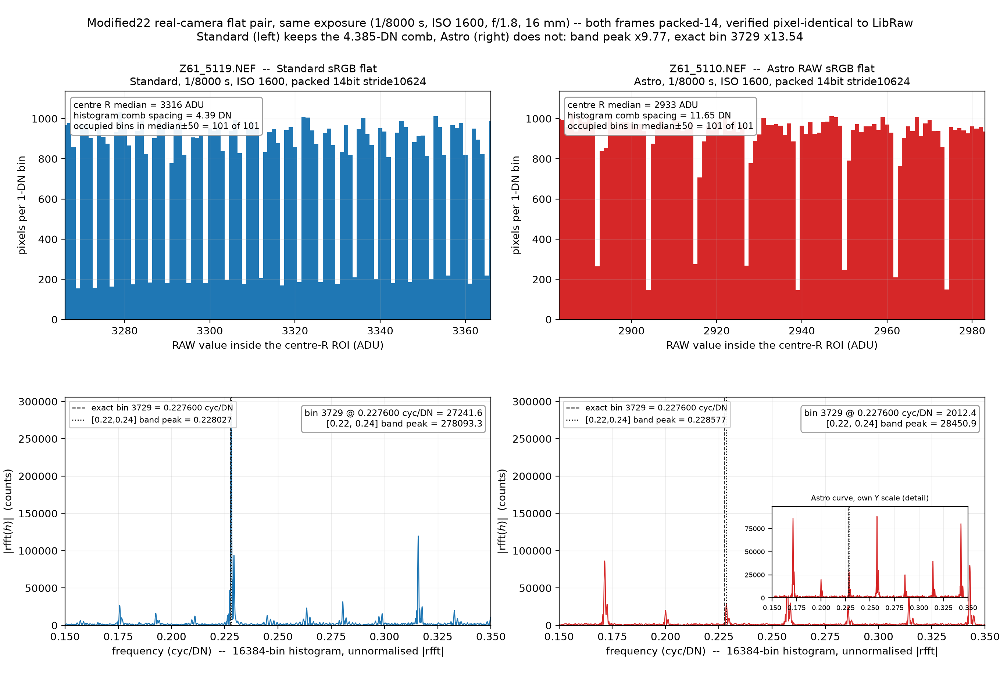
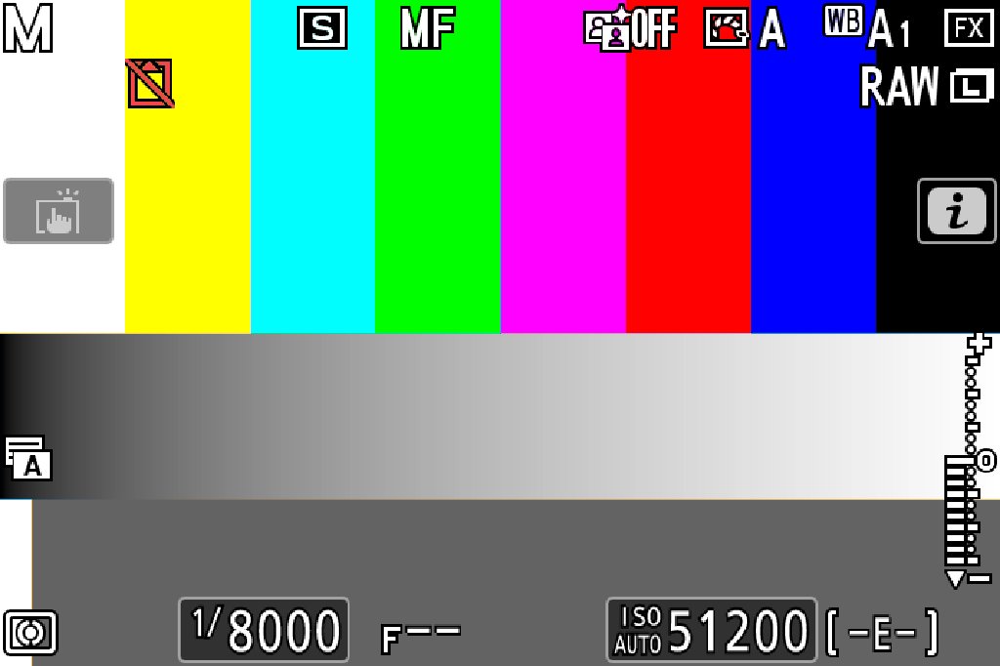
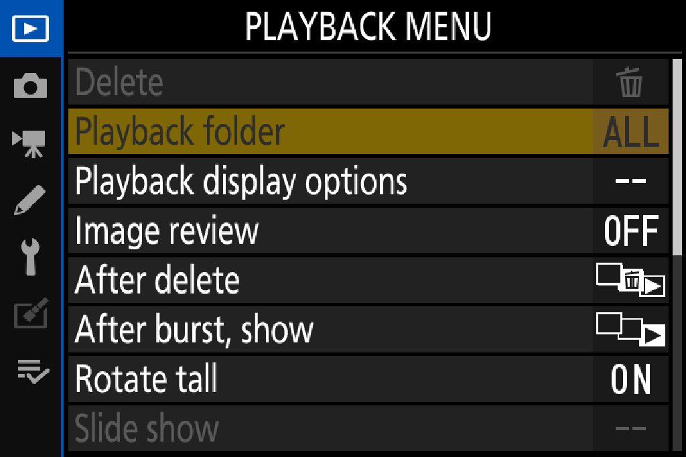

# Nikon Z6 C3.80 Astro RAW & Extended Exposure Firmware (Modified22)

> 🌐 **Language / 语言**: **[简体中文](README.md)** | **English**

[](LICENSE)
[](https://downloadcenter.nikonimglib.com/en/download/fw/557.html)
[](https://github.com/sedirk/nikon-z-astro-firmware/releases/tag/v3.80-modified22)

An open-source reverse-engineering and firmware enhancement suite for the **Nikon Z6 (official firmware C3.80)**. By reconstructing key stages of the in-camera Image Signal Processor (ISP), RTOS property evaluators, and menu/timer state machines, **`Modified22`** resolves the three long-standing limitations affecting deep-sky astrophotography and night-sky time-lapse imaging on first-generation Nikon Z mirrorless bodies: **hardcoded RAW spatial vignette/gain comb artifacts (Concentric Colored Rings), aggressive dark-frame hot-pixel clamping ("Star Eater" & broken dark-frame subtraction), and the 30-second M-mode shutter cap / start-to-start interval timer bottleneck**.

---

## 1. Feature Matrix

| Problem / Capability | Stock Nikon C3.80 Behavior | `Modified22` Enhanced Behavior | Technical Mechanism & Evidence |
| :--- | :--- | :--- | :--- |
| **Concentric Colored Rings**<br>*(RAW Histogram Comb)* | Frontend ISP injects mandatory $4.39\text{ DN}$ periodic digital gain & 2D spatial shading modulation into full-size RAW, creating periodic missing codes ($0.2276\text{ cyc/DN}$ FFT spike) and severe colored rings under deep-sky stretching | **Decisively Suppressed**: Selecting `Astro RAW (sRGB)` yields smooth continuous RAW histograms, reducing comb spectral peaks by **$9.8\sim 13.5\times$** ($0.2276\text{ cyc/DN}$ bin drops from $27,242$ to $2,012$; `[0.22, 0.24]` band peak drops from $278,093$ to $28,451$) | Routes full-size frontend RAW directly past backend replacement buffers, zeroes 54 2D polynomial terms, and locks 4-channel Q12 digital multipliers to unity $1.0\times$ (`4096`) (see [Tech Doc 01](docs/01_ASTRO_RAW_AND_CONCENTRIC_RINGS_EN.md)) |
| **Star-Eater & Dark Clamping**<br>*(Hot Pixel Suppression)* | Backend ISP applies aggressive $3\times 3$ same-color neighborhood clamping (`max8 + 8k`), erasing faint single-pixel pinpoint stars and invalidating Master Dark calibration | **True Physical Preservation**: Completely bypasses neighborhood hot-pixel suppression; faint stellar photons and true dark-current hot pixels are recorded linearly for clean dark subtraction | Frozen 112 hot-pixel benchmark records `0/112` clamp hits on lossless 5s darks (`0/95` on clean rows of M22 uncompressed 5s darks), unclipped frame-diff readout noise $\approx 4.11\text{ DN}$ ($3.54\text{ DN}$ central 68%), and zero `0 ADU` clipped pixels (see [Tech Doc 02](docs/02_STAR_EATER_AND_DARK_CURRENT_EN.md)) |
| **Seamless Menu Toggle & sRGB Lock**<br>*(UI-Switchable Astro Mode)* | Cannot disable internal RAW spatial scaling; earlier prototypes coupled Astro mode to NEF compression options | **Native Menu Switch**: Toggle freely under `Photo Shooting Menu -> Astro RAW mode` (`Standard (sRGB)` vs `Astro RAW (sRGB)`), decoupled from NEF compression (use **Lossless compressed** for `>= 1s` exposures), with full `i`-menu, NVRAM, and `U1/U2/U3` support | Bound to genuine Color Space menu property `PID 0x0526` (`RAM 0xC24CDEA0`) while locking effective color space `PID 0x130A = 0` (`sRGB`) at `0x1014BB28` — filenames always remain `Z61_xxxx.NEF` (see [Tech Doc 03](docs/03_UI_SWITCH_AND_COLOR_SPACE_ARCHITECTURE_EN.md)) |
| **Resident `30"~600"` Shutter Speeds**<br>*(Extended M-Mode Exposures)* | M-mode timed exposures stop at `30"`, requiring external intervalometers or manual Bulb/Time actuation for longer subs | **8 Built-in Long Shutter Steps**: Directly dial **`60", 90", 120", 180", 240", 300", 480", 600"`** in M mode without an external release cable | Extends 1/3-EV shutter lookup tables, UI labels, and exposure timer dividers (see [Tech Doc 04](docs/04_EXTENDED_SHUTTER_AND_INTERVAL_TIMER_EN.md)) |
| **Post-Exposure Pure Wait Intervalometer**<br>*(Interval Timer Shooting)* | Stock interval is measured *start-to-start*, shrinking sensor cooldown gaps or dropping frames whenever exposure + LENR exceeds interval | **Countdown Starts After Exposure**: Configured interval acts as pure post-exposure wait/cooldown gap, with dynamic **End day/time** calculation accounting for exposure + LENR + delay | Hooks exposure-completion callback `0x101FF392` and injects dynamic end-time predictor `0x1049C26C -> 0x1002E000` (see [Tech Doc 04](docs/04_EXTENDED_SHUTTER_AND_INTERVAL_TIMER_EN.md)) |
| **100% Factory Auto ISO Parity**<br>*(Auto ISO Control)* | Normal operation | **100% Factory Identical**: Restores `PID 0x0508` / `PID 0x1381` Auto ISO control and submenu graying across P/A/S/M modes (`Modified21` regression eliminated) | Restores exact Stock C3.80 bytes at `0x1040AD00` and `0x1014F678` |

---

## 2. Real-Camera Verification

Matched flat, dark, and bias frames captured on a physical Nikon Z6 running **`Modified22`** confirm end-to-end signal integrity:



- **Left Column (`Standard (sRGB)`)**: Around the ~3300 DN flat-field peak, the RAW histogram exhibits periodic missing-code spikes, producing an intense $278,093$ FFT comb peak in the $0.2276\text{ cyc/DN}$ band;
- **Right Column (`Astro RAW (sRGB)`)**: The histogram follows a smooth physical Poisson-Gaussian envelope with comb amplitude suppressed by **$9.8\sim 13.5\times$** ($0.2276$ bin reduced from $27,242$ to $2,012$; band peak reduced to $28,451$), while preserving standard `Z61_xxxx.NEF` naming and native `sRGB` EXIF/preview metadata.

---

## 3. Download, Flash & Reproducible Local Build

We provide both **ready-to-flash pre-packaged release archives** on GitHub Releases and a **zero-dependency reproducible Python builder** (the Git source tree tracks only clean-room source code, JSON recipes, and audit evidence).

### 3.1 Option A (Recommended): Direct Download from GitHub Releases
1. Download the pre-packaged flash kit from **[GitHub Releases (`v3.80-modified22`)](https://github.com/sedirk/nikon-z-astro-firmware/releases/tag/v3.80-modified22)**:
   - 📦 **[`Nikon-Z6-C380-Modified22-Astro-Firmware.zip`](https://github.com/sedirk/nikon-z-astro-firmware/releases/download/v3.80-modified22/Nikon-Z6-C380-Modified22-Astro-Firmware.zip)** (`29,318,898` bytes, SHA-256: `066ae056b5a84207ca7d99f31fedfc17f09c70283fbb466688137e5eed342e24`)
   - 🔑 **[`SHA256SUMS.txt`](https://github.com/sedirk/nikon-z-astro-firmware/releases/download/v3.80-modified22/SHA256SUMS.txt)** (standalone SHA-256 checksum manifest)
2. Extract the archive. Inside `Nikon-Z6-C380-Modified22-Astro-Firmware/` you will find:
   - `01_MODIFIED22/EG162080.BIN`: **`Modified22` Astro Firmware** main module (`33,502,842` B, SHA-256: `c6a23ea40f03d83c6c721e96e8b5af8a8422a7b4ed81d39222392b7635681771`, CRC-16/XMODEM: `0x48f3`);
   - `02_STOCK_C380_ROLLBACK/EG162080.BIN`: **Official Stock C3.80 rollback** module (`33,502,842` B, SHA-256: `1e6348d58750e67372d0a8e363932c57ee9c04d0eb8f62803bcd19812df0d25c`);
   - `verify.py` & `FLASH_INSTRUCTIONS.txt`: Run `python verify.py` inside the extracted folder before flashing to verify SHA-256, CRC-16, and all 104 patch sites offline.

### 3.2 Option B: Reproducible Local Build from Official Firmware (Optional)
1. Download official Nikon Z6 firmware C3.80 from the [Nikon Download Center](https://downloadcenter.nikonimglib.com/en/download/fw/557.html) and extract `Z_6_0380.bin` (SHA-256: `ff978ffdf77c58c0b861a06e16d432d5886969f3cdd05d62f6c8e82e8a4cea54`);
2. Run the standalone builder (requires **Python 3.10+ standard library only**; reproduces the byte-identical folder and `.zip` archive in ~1 second):
   ```bash
   python tools/build_modified22.py --stock /path/to/Z_6_0380.bin --output-dir outputs/Nikon-Z6-C380-Modified22-Astro-Firmware --zip
   ```

### 3.3 Camera Flashing & Rollback Steps
1. Format an XQD / CFexpress memory card inside the camera;
2. Copy `01_MODIFIED22/EG162080.BIN` to the **root directory** of the memory card (ensure only **one** `.BIN` file is present at the card root);
3. Insert a **fully charged genuine Nikon battery**, power on, navigate to **`Setup Menu -> Firmware version`**, select **`Update`**, and follow on-screen prompts;
4. **Never** power off the camera or remove the battery/card during the update. Restart the camera when prompted.

> [!TIP]
> Whenever the camera boots normally into the menu system, you can place `02_STOCK_C380_ROLLBACK/EG162080.BIN` at the memory card root and run `Firmware version -> Update` to revert cleanly to 100% Stock C3.80.

### 3.4 In-Camera Operation & QEMU UI Preview (Historical Prototype Illustration)
Menu navigation and display pipelines were validated in a QEMU system-emulation harness prior to hardware testing (screenshots below show an earlier prototype UI for interaction reference):

| LiveView & Info Strip | Menu System & Mode Selection |
| :---: | :---: |
|  |  |

1. **Enable Astro RAW**: Open `Photo Shooting Menu -> Astro RAW mode` (replaces *Color space*) and select **`Astro RAW (sRGB)`** (`直通RAW (sRGB)`);
2. **Quick Access**: Save the mode to `U1/U2/U3` or toggle it via the `i` menu;
3. **Extended M-Mode Shutter**: Turn the mode dial to **M** and rotate the main command dial past `30"` to select **`60"`, `90"`, `120"`, `180"`, `240"`, `300"`, `480"`, `600"`**.

> [!IMPORTANT]
> **Long-Exposure Recording Setting (`>= 1s`)**: When shooting **`>= 1s` exposures** with **`Astro RAW (sRGB)`** enabled, always set **`NEF (RAW) recording -> NEF (RAW) compression`** to **`Lossless compressed`** (14-bit). Real-camera auditing found that combining `Astro RAW + 5s + Uncompressed` writes a 16-bit LE stream whose bottom rows (`3633..4000`) overlap embedded JPEG preview offsets and trigger LibRaw packed-14 misdecoding, whereas **14-bit Lossless compressed** writes standard Nikon lossless NEFs verified clean in `LibRaw 0.22.2 / rawpy` with zero preview overlap (see the [Modified22 Real-NEF Audit Report](docs/MODIFIED22_REAL_NEF_AUDIT_2026-11-17_EN.md)).

---

## 4. Technical Documentation & Quantitative Evidence

Across 22 iterative builds (`Modified1` – `Modified22`), every binary patch, property-table discovery, and real-camera pixel metric has been documented:

1. **[Tech Monograph 01 — Astro RAW Pipeline Reconstruction & Concentric Ring Elimination](docs/01_ASTRO_RAW_AND_CONCENTRIC_RINGS_EN.md)**  
   *Disassembly of 13 ISP hooks, 54-term 2D shading polynomial sanitization, and Q12 unity-gain locking.*
2. **[Tech Monograph 02 — Bypassing Star-Eater & Preserving Physical Dark Current](docs/02_STAR_EATER_AND_DARK_CURRENT_EN.md)**  
   *Analysis of the `0x100C2654` $3\times 3$ same-color neighborhood clamp bypass and frozen 112 hot-pixel regression benchmarks.*
3. **[Tech Monograph 03 — Seamless UI Switch & Dual-Layer Color Space Architecture](docs/03_UI_SWITCH_AND_COLOR_SPACE_ARCHITECTURE_EN.md)**  
   *Root-cause post-mortem of the `PID 0x0508` Auto ISO misidentification and the `PID 0x0526` + `PID 0x130A = 0 (sRGB)` solution.*
4. **[Tech Monograph 04 — M-Mode 600s Extended Shutter & Post-Exposure Interval Timer](docs/04_EXTENDED_SHUTTER_AND_INTERVAL_TIMER_EN.md)**  
   *Shutter table extension, exposure-complete callback hooking (`0x101FF392`), and dynamic end-time prediction (`0x1002E000`).*
5. **[Real-Camera Audit — Modified22 18-NEF Pixel-Level Verification & Boundary Report](docs/MODIFIED22_REAL_NEF_AUDIT_2026-11-17_EN.md)**  
   *Full frame-by-frame flat/dark/bias metrics, sRGB lock verification, and 16-bit LE preview-overlay analysis.*
6. **[Tools & Reproducible Build Guide](docs/TOOLS_EN.md)** / **[Documentation Index](docs/README_EN.md)**  
   *Guide to `build_modified22.py`, clean-room container XOR mask recovery, and automated repository hygiene checks.*
7. **[Machine-Readable Sample Evidence Catalog](docs/SAMPLE_EVIDENCE_CATALOG.json)**  
   *SHA-256 digests, EXIF/MakerNote metadata, and spectral/noise measurements across all 121 real-camera NEF test frames.*

---

## 5. Acknowledgements & Credits

This project builds upon foundational research and tooling from the open-source camera reverse-engineering and astrophotography communities:

- **[Wonder-Lantern / z6-qemu / z7-qemu](https://github.com/WonderLantern)**: Created by **vic2349** and the WonderLantern contributors, enabling safe offline execution and peripheral emulation before physical camera testing.
- **[RealCaCl2 / z30-firmware-extensions](https://github.com/RealCaCl2/z30-firmware-extensions)**: Clean-room spanning-tree XOR mask recovery methodology, CRC conventions, and Nikon Z firmware container insights.
- **[Mark Shelley](https://www.markshelley.co.uk/Astronomy/concentric_ring_diagnosis.html)**: Pioneering diagnosis of Nikon's concentric colored rings and FFT histogram comb quantification methodology.
- **[Simeon Pilgrim / Nikon-Patch](https://simeonpilgrim.com/nikon-patch/nikon-patch.html)**: Early DSLR firmware patching and dark-current preservation research that inspired the community.

---

## 6. License

Original code, patch recipes, and documentation in this repository are licensed under the **[GNU General Public License v3.0 or later (`GPL-3.0-or-later`)](LICENSE)**. See **[THIRD_PARTY_NOTICES.md](THIRD_PARTY_NOTICES.md)** for third-party attributions and proprietary firmware notices.

```text
This program is free software: you can redistribute it and/or modify
it under the terms of the GNU General Public License as published by
the Free Software Foundation, either version 3 of the License, or
(at your option) any later version.

This program is distributed in the hope that it will be useful,
but WITHOUT ANY WARRANTY; without even the implied warranty of
MERCHANTABILITY or FITNESS FOR A PARTICULAR PURPOSE.  See the
GNU General Public License for more details.
```

*Disclaimer: Flashing modified camera firmware carries inherent hardware risks. Read all flashing and recording instructions carefully before proceeding; you assume sole responsibility for any operational errors or hardware damage.*
