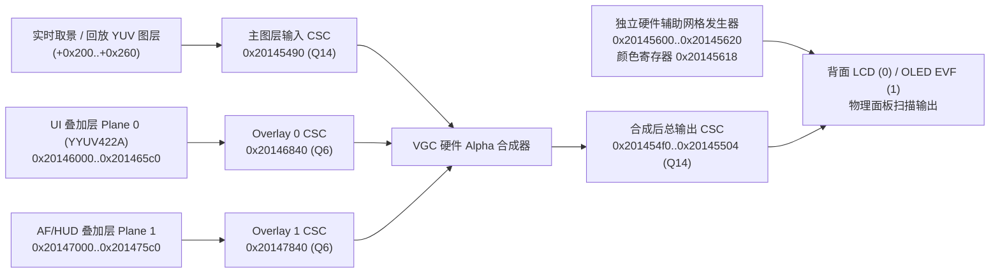

# 尼康 Z6 夜视红光模式（天文暖色显示）逆向工程与硬件后端架构设计

> 🌐 **语言 / Language**: **简体中文** | **[English](NIGHT_VISION_RED_DISPLAY_ARCHITECTURE_EN.md)** · 🏠 [返回文档索引](README.md)

## 1. 背景与核心设计约束

深空与暗空星野拍摄现场需要严格保护观测者的人眼暗适应（视紫红质对蓝绿波段极度敏感，约 `498 nm` 峰值）。尼康自 EXPEED 7 世代（Z9 / Z8 / Zf / Z6III）起在原厂固件中新增了自定义设定 **`d11：暖色显示屏颜色（Warm display colors）`**（含 `Mode 1` 仅菜单/UI 暖红、`Mode 2` 全画面 + UI 纯红，以及暖色亮度调节），而初代尼康 Z6（EXPEED 6，C3.80）原厂缺乏该能力。

在初代 Z6 上实现天文夜视红光显示必须同时满足四项硬性工程边界：
1. **实拍与测光 100% 物理隔离**：红光变换必须且只能作用于显示控制器（VGC）末端扫描输出级，严禁触碰前端 BAYER / RAW DMA、机内与内嵌预览 JPEG 编码、自动曝光（AE）测光、自动对焦（AF）相位/反差评估及实时取景直方图统计；
2. **背面 LCD 与 OLED EVF 统一覆盖，HDMI 净输出不受污染**：机身背面显示屏与电子取景器在切换时均须保持纯红无绿蓝光泄漏，同时外接 HDMI 采集/监看保持原厂正常色彩（与尼康 Z8 `d11` 官方行为一致）；
3. **解决绿框对焦指示消失问题**：原厂对焦合焦框与部分状态图标采用纯绿色（`G` 主导），若直接照搬纯红通道提取矩阵会导致绿色合焦框完全变黑消失，必须提供兼顾色彩语义或亮度保持的双模式硬件配方；
4. **开关载体正交无冲突**：与「照片拍摄菜单 -> 色空间」承载的天文直通 RAW 开关（`PID 0x0526` @ `RAM 0xC24CDEA0` 及有效色空间锁 `PID 0x130A` @ `RAM 0xC24CC74C`）完全正交，借用「设定菜单 -> 信息显示」（`PID 0x1111` @ `RAM 0xC24DD0EC`），支持置顶「我的菜单」配合自定义按键在全黑环境下单键盲切。

---

## 2. 尼康 Z8（C3.12）原厂 `d11：暖色显示屏颜色` 逆向基准

由于尼康 Z8 官方固件（C3.12 主镜像 `eg2070_031200.bi`，`81,807,711` 字节，SHA-256 `0a0a0afda5d11049bbbbab698c8db88223fda6ecf2d1231c68aa8f8f93b0a09a`，AArch64 加载基址 `0x40160000`，`.data` 映射至 `RAM 0x0a02808000`）仍采用可离线解析的第一代外层包结构，我们完整提取了原厂 `d11` 的控制流与色彩参数真值：

### 2.1 属性 ID、状态机与双通道硬件拓扑
- **原厂设置项属性（`eDSID`）**：
  - `0x027b`：`StarlightView`（星光视图）；
  - `0x027c`：`WarmDisplayColorOptions`（`d11` 模式：`0 = Off`，`1 = Mode 1`，`2 = Mode 2`）；
  - `0x027d`：`WarmDisplayColorBrightness`（暖色显示屏亮度微调）。
- **上层状态同步与硬件分发**：
  - 设置同步模块 `0x40591c80..0x40594150` 与显示配置构建器 `0x4041da80..0x4041dd40` 将 `d11` 状态写入主显示上下文 `0x0a02e70c98` 的偏移 `+0x314` / `+0x315`；
  - 底层双通道显示引擎由 `DISP0`（描述符 `0x0a02808438`，MMIO `0x15480000`，LUT `0x15c80000`）与 `DISP1`（描述符 `0x0a02808470`，MMIO `0x15484000`，LUT `0x15c84000`）组成，统一经 CSC 写入器 `0x402aaba0`（子偏移 `+0x528`、`+0x3864`、`+0x1510`）与 33 点 11-bit LUT 写入器 `0x402ade58` / `0x402ae1e4` 下发硬件。

### 2.2 原厂硬件 CSC 矩阵族与 33 点暖色曲线
Z8 在指针表 `0x4167a240..0x4167a460` 与常量表 `0x4167bb78..0x4167bbb0` 中定义了两类核心定点矩阵：

| 管线位置与指针锚点 | RAM 数据结构 | 定点格式 | `3×3` 系数行展开 `(m00..m22)` | 物理含义 |
| :--- | :--- | :---: | :--- | :--- |
| 主通路红光抑制矩阵 `0x4167a2f0` | `0x0a02811010` | Q10 (`1024 = 1.0`) | `(87, -29, -2, 0, 0, 0, 0, 0, 0)` | 压暗并完全清零 `G/B` 输出行，仅保留低照度红光行 |
| 主通路红光抑制矩阵 `0x4167a2f8` | `0x0a02811028` | Q10 (`1024 = 1.0`) | `(75, -18, -1, 0, 0, 0, 0, 0, 0)` | 第二色温档纯红输出矩阵（`G = 0, B = 0`） |
| 主通路高对比红光矩阵 `0x4167a2d0` | `0x0a02810fe0` | Q10 (`1024 = 1.0`) | `(382, -128, -12, 0, 0, 0, 0, 0, 0)` | 中高亮度档纯红输出矩阵（净单色比例约 `0.236`） |
| 图层标准 `YCbCr -> RGB` `0x4167bb78` | `0x0a02810d9e` | Q6 (`64 = 1.0`) | `(64, 0, 90, 64, -22, -46, 64, 113, 0)` | BT.601 全范围标准彩色合成输出 |
| **图层 `Mode 2` 纯红提取 `0x4167bb88`** | `0x0a02810dc2` | Q6 (`64 = 1.0`) | **`(15, 0, 21, 0, 0, 0, 0, 0, 0)`** | 按 `0.234375×(Y + 1.40625 Cr)` 提取红通道并硬清零 `G/B` |
| **图层单色纯红提取 `0x4167bb90`** | `0x0a02810dd4` | Q6 (`64 = 1.0`) | **`(15, 0, 0, 0, 0, 0, 0, 0, 0)`** | 按 `0.234375×Y` 将全亮度映射至纯红通道并硬清零 `G/B` |

同时，Z8 在 `0x4167a440`（`0x0a02811e40` / `0x0a02811ec0`）配置了 33 点暗部抬升与高光滚降非线性 LUT（输入步进非均匀加密暗部：`2, 4, 6, 8, 12, 16 ... 7680`，输出峰值 `8190`），并在软件调色板层通过 `0x402ba1f8`（跳表 `0x41674338` Cases `0..4` @ `0x402ba50c..0x402ba77c`，sRGB 线性化常量池 `0x41674360..0x41674440`：`0.04045`, `12.92`, `0.055`, `1.055`）及提交器 `0x402d2350` 对 UI 调色板重着色，硬件辅助网格颜色则由 `0x402ab46c` 独立写入。

---

## 3. 初代尼康 Z6（C3.80）VGC 显示硬件精确映射

对照反汇编尼康 Z6 C3.80 主固件（`eg1620_038000.bi`，加载基址 `0x10020000`）的显示控制器驱动 `0x10242f00..0x10245700`、子块寄存器偏移表 `0x106197b4`（紧邻 `0x10619780` `_vgcRmIf_getPPFCCompSwapFromNativeFormat`）以及上下层显示管理器，Z6 与 Z8 的显示后端呈现清晰的同源映射关系，但**通道分工存在关键差异**：

### 3.1 Z6 VGC 双实例拓扑：机身内屏（LCD + EVF）与外接 HDMI 物理分离
全固件仅有两处调用 VGC 通道打开入口 `0x1024303e`（句柄数组 `0xc180122c`，句柄 `+4` 存储 `unit_off`）：

1. **通道 1（`unit_off = 0x4000`，MMIO `0x20144000..0x20147fff`）—— 机身内部显示管理器 Manager A（`0x1023c800..0x10242000`，状态结构体 `0xc180a56c`，标识 `"HAIMENMONI"`）**：
   - **同时分时承载背面 LCD 与 OLED EVF**：眼传感器切换取景方式时，Manager A 更新状态字节 `[0xc180a56c]`（`0` = 背面 LCD 面板驱动 `0x1024784c`；`1` = OLED EVF 桥接器 `[r4, #0x14]` `0x102456da`），并在 `0x1023f24c` 中按 `[0xc180a56c]` 索引只读矩阵表 `0x1062dc28` 重新加载 `0x20145490` 与 **`0x201454f0`**；
   - 因此，**只需拦截 `unit_off == 0x4000`（Manager A），即可自动、同步覆盖背面 LCD 与 OLED EVF 两种机内取景介质**。
2. **通道 0（`unit_off = 0x0000`，MMIO `0x20140000..0x20143fff`）—— 外接 HDMI 管理器 Manager B（`0x1034b800..0x10351000`，状态结构体 `0xc1809184`，标识 `"HDMI"`）**：
   - 在 `0x1034e758` 中依据色域与量化范围从 `0x1062ccdc..0x1062cdb4` 选择 BT.601 / BT.709 矩阵；
   - 对钩子施加 **`unit_off == 0x4000` 门控**后，通道 0 保持原厂字节不改，外接 HDMI 录机或监视器画面自动保持 100% 正常彩色。

### 3.2 Z6 通道 1（`0x20144000`）末端显示管线与关键寄存器

| 功能模块 | Z6 驱动写入函数 | Manager A 调用点 | 通道 1 寄存器地址 (`unit_off = 0x4000`) | 原厂默认值与位域格式 |
| :--- | :--- | :--- | :--- | :--- |
| **合成后总输出 CSC** | `0x1024341e(hdl, 8, 1, mat)` | `0x1023f284`（位于 `0x1023f24c`，查表 `0x1062dc4c` / `0x1062dc5e`） | `0x201454f0..0x20145504`（6 个 32-bit 词打包 `9 × int16`） | Q14 (`16384 = 1.0`)：`(16384, 0, 23040, 16384, -5632, -11776, 16384, 28928, 0)` |
| **UI 叠加层 0 CSC** | `0x1024341e(hdl, 2, 1, mat)` | `0x1023df50`（脏标记 `[r1, #0x4d8]` @ `0x1023df34`） | `0x20146840..0x20146848`（3 个 24-bit 词打包 `9 × int8`） | Q6 (`64 = 1.0`)：`(64, 0, 90, 64, -22, -46, 64, 113, 0)` |
| **AF/HUD 叠加层 1 CSC** | `0x1024341e(hdl, 4, 1, mat)` | `0x1023df50` | `0x20147840..0x20147848`（3 个 24-bit 词打包 `9 × int8`） | Q6 (`64 = 1.0`)：`(64, 0, 90, 64, -22, -46, 64, 113, 0)` |
| **硬件构图网格颜色** | `0x10244086(hdl, cfg_28B)`（经 `0x1025a950` 校验 `+0x304` 尺寸） | `0x1023e3b0 -> 0x102408fa`（上层 `0x1023e502`, `0x1023f438`） | `0x20145618` | `bits[25:24]` 不透明度档位（`×85`），`bits[7:0]=R`, `bits[15:8]=G`, `bits[23:16]=B` |

> [!IMPORTANT]
> 注意架构图右侧的一项关键硬件细节：**VGC Layer 4 硬件构图网格（`0x20145600..0x20145620`）为独立矩形发生器，其颜色寄存器 `0x20145618` 不经过 `0x20146840 / 0x20147840` 图层 CSC**。因此无论是 `Mode 1` 还是 `Mode 2`，都必须同步将 `0x20145618` 的 `G`、`B` 字节清零（例如写入 `0x02000090`，即 `R = 0x90, G = 0x00, B = 0x00, alpha = 2`），否则开启 `d10：构图网格显示` 时会出现红屏上残留白色/灰色网格线的漏光现象。

---

## 4. 双模式红光寄存器配方与 `256^3` 全色域零泄漏证明

对标尼康 Z8 `d11` 的双模式设计，并针对初代 Z6 绿色合焦框（`RGB = (0, 255, 0)`）的可见性痛点，我们给出精确到寄存器十六进制字的双模式配方：

### 4.1 模式定义与精确寄存器载荷

1. **Mode 1（仅 UI / 菜单 / 信息屏纯红，实时取景底图保持原彩）**：
   - **适用场景**：需要对星云/地景色彩或峰值对焦颜色做彩色判读，但希望菜单、参数栏与构图网格不刺眼；
   - **寄存器配置（仅 `unit_off == 0x4000`）**：
     - `0x201454f0..0x20145504`（总输出 CSC）：保持原厂 BT.601 矩阵不变；
     - `0x20146840..0x20146848` & `0x20147840..0x20147848`（Overlay 0/1 CSC）：写入 Q6 亮度转纯红矩阵 `(64, 0, 0, 0, 0, 0, 0, 0, 0)`（打包后 `0x20146840 = 0x00000040`, `+4 = 0x00000000`, `+8 = 0x00000000`）；
     - `0x20145618`（硬件网格颜色）：强制掩码清零 `bits[23:8]`（`G=0, B=0`），保留 `R` 与 `alpha`（如 `0x02000090`）。

2. **Mode 2A — 亮度保持纯红模式 `LumaRed`（天文实拍首选推荐）**：
   - **适用场景**：全黑环境下完整保护人眼暗适应，同时**确保绿色合焦框、蓝色/青色高亮提示框与菜单选中项按原有明暗层次转化为清晰可见的纯红灰阶**；
   - **寄存器配置（仅 `unit_off == 0x4000`）**：
     - `0x201454f0..0x20145504`（总输出 CSC）：写入 Q14 矩阵 **`(12288, 0, 0, 0, 0, 0, 0, 0, 0)`**（即 $R_{\text{out}} = 0.75 \times Y$，$G_{\text{out}} = 0$，$B_{\text{out}} = 0$；6 个寄存器依次写入 `0x00003000, 0x00000000, 0x00000000, 0x00000000, 0x00000000, 0x00000000`）；
     - `0x20145618`（硬件网格颜色）：`0x02000090`（`R = 144, G = 0, B = 0, alpha = 2`）。

3. **Mode 2B — Z8 `0x4167bb88` 等效纯红通道提取模式 `Z8EqRed`（对照备选）**：
   - 将 Z8 Q6 矩阵 `(15, 0, 21, 0..0)` 精确无损换算至 Z6 Q14 域（$\times 256$）：**`(3856, 0, 5423, 0, 0, 0, 0, 0, 0)`**（寄存器写入 `0x00000f10, 0x0000152f, 0, 0, 0, 0`）；
   - 该矩阵严格只提取源画面的 `R` 分量（约 $0.235 \times R$），因此纯绿 AF 合焦框 `(0, 255, 0)` 会映射为 `(0, 0, 0)` 完全隐没；若选用 `Mode 2B`，必须配合 `Overlay 1` 使用 `(48, 0, 0, 0..0)` 单独保留合焦框亮度。

### 4.2 全色域 `16,777,216` 色（$256^3$）穷举证明与 Unicorn 实测结果

在 Python / NumPy 中对全部 $256 \times 256 \times 256 = 16,777,216$ 种输入 `(R, G, B)` 逐点执行 Z6 VGC 定点前向变换（`0x1062dc28` Q14 `RGB -> YCbCr`）与末端 `0x201454f0` Q14 输出变换，并用 Unicorn Thumb-2 引擎直接执行固件原生函数 `0x1024341e` 与 `0x10244086`：

| 验证配置 | Unicorn `0x1024341e` / `0x10244086` 返回值与 MMIO 落点 | 全色域 `max(G)` / `max(B)` | 纯白 `(255,255,255)` 输出 | 绿 AF 框 `(0,255,0)` 输出 | 纯红 `(255,0,0)` 输出 | 纯蓝 `(0,0,255)` 输出 |
| :--- | :--- | :---: | :---: | :---: | :---: | :---: |
| 原厂默认 `Stock` | `ret = 0`，写入 `0x201454f0..0x20145504`（往返最大定点舍入误差 `dR=1, dG=3, dB=5`） | `255 / 255` | `(255, 255, 255)` | `(0, 255, 0)` | `(255, 0, 0)` | `(0, 0, 255)` |
| **`Mode 2A: LumaRed`** | `ret = 0`，`0x201454f0 = 0x00003000`，其余 5 词全 `0`；Grid `0x20145618 = 0x02000090` (`ret = 0`) | **`0 / 0`** | **`(191, 0, 0)`** | **`(113, 0, 0)`** | **`(57, 0, 0)`** | **`(21, 0, 0)`** |
| **`Mode 2B: Z8EqRed`** | `ret = 0`，`0x201454f0 = 0x00000f10`，`0x201454f4 = 0x0000152f`，其余 4 词全 `0` | **`0 / 0`** | **`(60, 0, 0)`** | `(0, 0, 0)` | **`(60, 0, 0)`** | `(0, 0, 0)` |
| **`Mode 1: OvlRed`** | `ret = 0`，`0x20146840 = 0x00000040`，`0x20147840 = 0x00000040`；Grid `0x20145618 = 0x02000090` | UI 层 **`0 / 0`** | UI `(255, 0, 0)` | UI `(150, 0, 0)` | UI `(76, 0, 0)` | UI `(29, 0, 0)` |

---

## 5. 静态调用图隔离审计与 `z6-qemu` 仿真边界说明

### 5.1 实拍 RAW / JPEG / 测光 / 对焦零污染证明
对 `eg1620_038000.bi` 全固件所有 Thumb-2 `BL` 调用边进行穷举扫描：
- 指向 `0x1024341e`（VGC CSC 写入器）、`0x1023f24c`（Manager A 总输出 CSC 配置）、`0x1023df10`（Manager A 叠加层配置）、`0x102408fa` 与 `0x10244086`（硬件构图网格配置）的外部跨模块调用者集合严格为空 `[]`——所有调用者 100% 封闭在 Manager A（`0x1023c000..0x10248000`）与 Manager B（`0x1034a000..0x10355000`）内部；
- 上述三个钩子函数的全部出向调用仅访问 VGC 寄存器驱动与 RTOS 同步原语（`0x10170cca` 延时、`0x101bceac` / `0x101d96d6` 互斥锁），与前端 RAW 管线（`0x100Axxxx` / `0x100Cxxxx` / `0x1012xxxx`）、JPEG 编码器及 AE/AF 测光模块不存在任何共享缓冲区或数据回流路径。

### 5.2 `z6-qemu` 显示仿真边界核查
核查本地 `z6-qemu` 外设模型（`nikon-z6.c`）：
- **完全支持项**：所有写入 `0x20144000..0x20147fff` 的 CSC 与网格寄存器值均完整记录在 `s->display_regs` 中并满足掩码校验（Overlay CSC 24-bit 掩码 `0x00ffffff`、Grid `0x03ffffff`），且硬件网格函数 `nikon_lcd_grid()` 直接按 `r[0x1618/4]` 实时渲染纯红网格线；
- **模型简化边界**：`nikon-z6.c` 中的 `nikon_lcd_present()` 当前采用固定 C 函数 `nikon_yuv_rgb()` 将实时取景 YUV 转为窗口像素（源码注释明确标注转换矩阵与可编程 LUT 尚未在 QEMU 像素呈送循环中执行）。因此，验证体系组合了 Unicorn 原生函数矩阵探针、`z6-qemu` 整机 GUI 按键切换 + MMIO 读回 + 纯红构图网格扫描像素差分（`RedGridDiffPx = 5109`）以及物理 Z6 机身真机刷写实测签收。

---

## 6. 正式版借壳菜单实现、`DISP` 暗色锁定与单帧无状态同步（`z6_night_vision_red.py`）

在正式版实现 [z6_night_vision_red.py](../tools/fw/z6_night_vision_red.py) 中，固件选用与色空间属性完全正交的**「设定菜单（扳手图标）-> 信息显示（Information display）」**承载天文夜视红光开关，并在 `Free Hole B`（`0x1002E1B0..0x1002EF00`）以 7 处零重叠补丁跨度完成硬件闭环：

### 6.1 借用的原厂菜单真值对照与首次开机 NVRAM 说明

| 维度 | 原厂 C3.80 原始定义 | 正式版固件改造后定义（`Modified24`） |
| :--- | :--- | :--- |
| **菜单入口与属性坐标** | 设定菜单 -> `信息显示` / `Information display` 菜单句柄 `0x104C4D54`（行 `0x1D1F`），描述符 `0x114D7E58` `PID 0x1111` -> `RAM 0xC24DD0EC`（`rom_default = 0` @ `0x114E3DF0`） | 菜单位置与属性地址保持不变，标题覆盖为 **`天文红光显示` / `Astro red display`**（全机身 36 种语言同步覆盖，字库字形命中率 `100%`） |
| **选项 `0`（出厂重置默认）** | `SID 0x0240`：`光亮时用暗字体` / `Dark on light`（回调 `0x104CE0A4`） 使背面 `DISP` 参数信息屏呈刺眼的白底黑字 | **`关闭 (标准色彩)` / `Off (Standard)`** 背面 LCD 与 OLED EVF 保持原厂标准全彩显示；执行「重设所有设定」默认回到此项 |
| **选项 `1`** | `SID 0x0241`：`黑暗时用亮字体` / `Light on dark`（回调 `0x104CE0AE`） 使背面 `DISP` 参数信息屏呈黑底亮字 | **`开启 (天文红光)` / `On (Astro Red)`** VGC 通道 1（背面 LCD + OLED EVF）切换为 `Mode 2A LumaRed` 纯红护眼显示，硬件网格同步去绿蓝；实拍 RAW/JPEG 与 HDMI 保持原彩 |
| **`DISP` 拍摄参数屏底色** | 随选项 `0 / 1` 在白底与黑底之间切换 | 经 `0x1040E7D8` 与 `0x1043A1E0` **永久锁定为护眼的「黑底亮字（Light on dark）」**，彻底淘汰暗空下刺眼的白底模式 |
| **暗场单键盲操方法** | — | 将「天文红光显示」添加至 **我的菜单（MY MENU）** 第一项，并在 `f2：自定义控制功能` 中将 `Fn1` 或 `Fn2` 设为「访问我的菜单首项」，即可全黑单键直达 |

> [!NOTE]
> **刷机后首次开机自动红光的原因与一键恢复说明**：尼康机身升级固件时会保留 NVRAM 中的用户个人设定。若刷机前您的相机在原厂固件下曾将「设定菜单 -> 信息显示」设为 **`黑暗时用亮字体`（存储值 `1`）**，刷入后首次开机读取到 `PID 0x1111 == 1` 会自动启用 **`开启 (天文红光)`**；只需进入「设定菜单 -> 天文红光显示」将其切回 **`关闭 (标准色彩)`（`0`）** 一次，即可持久化恢复正常全彩显示。

### 6.2 7 处零重叠补丁跨度与无状态单帧同步架构

1. **`0x1002E1B0`（`astro_red_cave`，占用 `1,176` B，剩余 `2,232` B 空闲）**：存放 `tramp_vgc_set_csc`（`0x1002E1B0`）、`tramp_vgc_set_grid`（`0x1002E1E4`）、`tramp_vgc_frame_sync`（`0x1002E20C`）、`tramp_astro_red_lang_str`（`0x1002E2A8`）、`mat_luma_red_q14`（`0x1002E2F4`：`[12288, 0..0]`）、`astro_red_ui_override_table`（`0x1002E308`）及多语言 UTF-16LE 字符串池（`0x1002E37C..0x1002E648`）；
2. **`0x10243422`（`vgc_set_csc` 入口跳板）**：仅当 `hdl->unit_off == 0x4000`（通道 1 LCD/EVF）、`(stage == 8, sub == 1)` 且 `u32[0xC24DD0EC] != 0` 时，将输出 CSC 矩阵指针重定向至 `mat_luma_red_q14`（`0x201454F0 = 0x00003000`）；通道 0（`unit_off == 0x0000` 外接 HDMI）原样放行；
3. **`0x10244154`（`vgc_set_grid` 颜色掩码跳板）**：仅当 `r0 == 0x20145000`（通道 1）且 `u32[0xC24DD0EC] != 0` 时，执行 `bfc r5, #8, #16` 清零 `[0x20145618]` 的 `G/B` 字节并完整保留 `R` 与不透明度 `alpha`（如原厂 `0x03D8D8D8` -> 纯红 `0x030000D8`）；
4. **`0x102435AE`（`vgc_update_src_buf` 无状态单帧即时同步）**：同时覆盖实时取景帧刷新（`0x1023D746`）与纯菜单/OSD 重绘（`0x1023DBD2`）。通过直接比对硬件寄存器 `[0x201454F0]` 当前首系数（`0x3000` vs `0x4000`）与 `[0xC24DD0EC]` 目标状态，**稳态下保持 `0` 次额外 MMIO 写入**；一旦菜单发生 `0 <-> 1` 翻转，无需额外 RAM 状态变量即可在单帧内调用 `0x1024341E` 并同步翻转 `[0x20145618]` 网格颜色，全程无面板重初始化黑屏闪烁；
5. **`0x1040E7D8`（`0124 -> 0024`）与 `0x1043A1E0`（`18d0 -> 18e0`）**：锁定两处 `DISP` 拍摄信息屏主题选择辅助函数恒定返回黑底亮字主题；
6. **`0x104C013C`（`GetLanguageString` 尾声链式跳板）**：紧接在天文直通 RAW 字符串覆盖跳板（`0x104C0134`）之后串联覆盖 `SID 0x023F / 0x0240 / 0x0241 / 0x054C`，随后执行原厂 `pop.w {r0..r8, pc}` 返回。

---

## 7. 多层自动化验证与真机实测闭环证据

1. **Unicorn 原生指令集全矩阵回归（[evidence/probe_modified24_native_result.json](evidence/probe_modified24_native_result.json)，`status = PASS`）**：
   - 覆盖 **`26` 组** VGC 通道 1 vs 通道 0（HDMI）CSC 矩阵隔离用例、**`12` 组**硬件构图网格颜色掩码用例、单帧无状态同步状态机（未初始化跳过、稳态开关 `0` 次 MMIO 写入、`0 -> 1 -> 0` 单帧切换还原、HDMI 零写入）、两处 `DISP` 黑底亮字锁定辅助函数，以及全固件 **36 种语言共 `648` 项** UI 字符串与邻近 `SID` 零误伤校验；
2. **`z6-qemu` 整机 GUI 菜单交互与帧缓冲扫描验证（[evidence/qemu_modified24_result.json](evidence/qemu_modified24_result.json)，`ok = true`）**：
   - 冷启动验证 `PID 0x1111 = 0`（通道 1 CSC 首字 `0x4000` 标准全彩）；通过模拟机身按键进入设定菜单开启「天文红光显示」后，通道 1 CSC 即时切换至 `0x3000, 0..0` 而通道 0（HDMI）保持 `0x0`；实时取景开启构图网格时，网格寄存器由 `0x03D8D8D8` 切换为纯红 `0x030000D8`，帧缓冲扫描输出实测 **`5,109` 个变化网格像素 100% 满足 `G = 0, B = 0` 纯红输出**，关闭后完整恢复 `0x4000` 与 `0x03D8D8D8`；
3. **刷写器安全审计与物理 Z6 真机验收（[evidence/modified24_updater_audit.json](evidence/modified24_updater_audit.json)）**：
   - 通过 **`7` 项**单模块升级文件检查（含跨版本升级/回退与异常 CRC/文件名拒绝）及 **`5` 项**离线扇区擦写调度审计；
   - **物理 Nikon Z6 机身真机刷写实测通过**：背面 LCD 与 OLED EVF（含眼传感器自动切换）在实时取景、菜单浏览、绿色合焦框、构图网格及 `DISP` 参数屏下均呈清晰纯红灰阶且无绿蓝漏光，切回 `关闭 (标准色彩)` 即时恢复原厂正常全彩。
