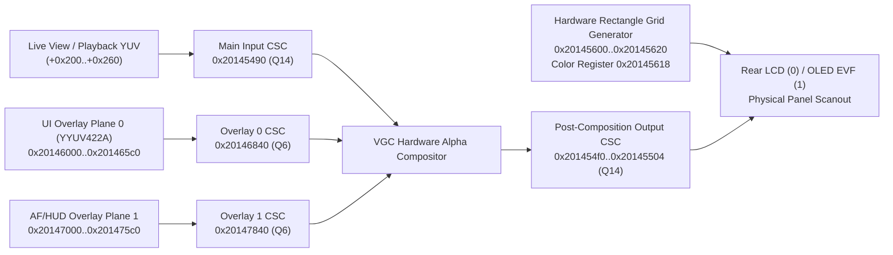

# Nikon Z6 In-Camera Night Vision Red Display (Warm Display Colors) Reverse Engineering & Backend Architecture

> 🌐 **Language / 语言**: **[简体中文](NIGHT_VISION_RED_DISPLAY_ARCHITECTURE.md)** | **English** · 🏠 [Back to Docs Index](README_EN.md)

## 1. Motivation & Hard Engineering Constraints

Deep-sky and dark-site wide-field astrophotography require strict preservation of human scotopic dark adaptation (rhodopsin peaks near `498 nm` in the blue-green band). Starting with the EXPEED 7 generation (Z9 / Z8 / Zf / Z6III), Nikon introduced Custom Setting **`d11: Warm display colors`** (`Mode 1` warm-red menus/UI over standard live view, `Mode 2` full-frame + UI red monochrome, plus warm brightness adjustment), whereas the first-generation Nikon Z6 (EXPEED 6, C3.80) lacks any warm/red display facility.

Implementing an astro-grade Night Vision Red Display on the Nikon Z6 must satisfy four strict invariants:
1. **100% Physical Isolation from Capture & Metering**: Red color conversion must execute exclusively at the terminal scanout stage of the Video/Graphics Controller (VGC), leaving Bayer/RAW DMA, embedded/companion JPEG encoding, Auto Exposure (AE) metering, Auto Focus (AF) evaluation, and live-view histograms completely untouched;
2. **Unified Rear LCD + OLED EVF Coverage with Clean External HDMI**: Both internal viewing surfaces (rear monitor and OLED viewfinder) must stay strictly free of green/blue leakage across eye-sensor switches, while external HDMI output stays 100% normal color (matching Nikon Z8 `d11` factory behavior);
3. **Preserving Green AF Box Legibility**: Stock in-focus AF confirmation boxes and status indicators are rendered in pure green (`G`-dominant). Naive red-channel extraction turns `(0, 255, 0)` completely black `(0, 0, 0)`, requiring a luminance-preserving red mapping alongside a Mode 1 UI-only option;
4. **Orthogonal UI Switch Carrier**: Completely disjoint from the Astro RAW switch on `Photo Shooting Menu -> Color space` (`PID 0x0526` @ `RAM 0xC24CDEA0` and effective color space lock `PID 0x130A` @ `RAM 0xC24CC74C`), hosted on `Setup Menu -> Information display` (`PID 0x1111` @ `RAM 0xC24DD0EC`) for one-button blind toggling via **MY MENU** top item + `f2` custom button assignment.

---

## 2. Factory Reference: Nikon Z8 (C3.12) `d11: Warm Display Colors`

Because Nikon Z8 firmware C3.12 (`eg2070_031200.bi`, `81,807,711` bytes, SHA-256 `0a0a0afda5d11049bbbbab698c8db88223fda6ecf2d1231c68aa8f8f93b0a09a`, AArch64 base `0x40160000`, `.data` mapped to `RAM 0x0a02808000`) uses a Gen-1 unpackable container, we extracted Nikon's exact `d11` control flow and fixed-point tables:

### 2.1 Property IDs (`eDSID`), State Context, and Dual Display Units
- **Factory Setting Properties (`eDSID`)**:
  - `0x027b`: `StarlightView`;
  - `0x027c`: `WarmDisplayColorOptions` (`d11` mode: `0 = Off`, `1 = Mode 1`, `2 = Mode 2`);
  - `0x027d`: `WarmDisplayColorBrightness`.
- **State Propagation & Hardware Dispatch**:
  - Upper state evaluators `0x40591c80..0x40594150` and display config builder `0x4041da80..0x4041dd40` latch the active warm state into master display context `0x0a02e70c98` at offsets `+0x314` / `+0x315`;
  - Dual hardware display pipes `DISP0` (`0x0a02808438`, MMIO `0x15480000`, LUT `0x15c80000`) and `DISP1` (`0x0a02808470`, MMIO `0x15484000`, LUT `0x15c84000`) are programmed via hardware CSC writer `0x402aaba0` (sub-offsets `+0x528`, `+0x3864`, `+0x1510`) and 33-point 11-bit LUT writers `0x402ade58` / `0x402ae1e4`.

### 2.2 Factory CSC Matrices & 33-Point Warm Tone Curves
Pointer table `0x4167a240..0x4167a460` and constant table `0x4167bb78..0x4167bbb0` hold Nikon's fixed-point matrices:

| Pipeline Stage & Pointer Anchor | RAM Struct | Fixed-Point Format | `3×3` Row-Major Coefficients `(m00..m22)` | Functional Role |
| :--- | :--- | :---: | :--- | :--- |
| Main Pipe Warm Red `0x4167a2f0` | `0x0a02811010` | Q10 (`1024 = 1.0`) | `(87, -29, -2, 0, 0, 0, 0, 0, 0)` | Attenuates red row and hard-zeroes `G` and `B` output rows |
| Main Pipe Warm Red `0x4167a2f8` | `0x0a02811028` | Q10 (`1024 = 1.0`) | `(75, -18, -1, 0, 0, 0, 0, 0, 0)` | Secondary warm-tint pure-red matrix (`G = 0, B = 0`) |
| Main Pipe Mid/High Red `0x4167a2d0` | `0x0a02810fe0` | Q10 (`1024 = 1.0`) | `(382, -128, -12, 0, 0, 0, 0, 0, 0)` | Higher-brightness pure-red matrix (net monochrome gain `~0.236`) |
| Plane Stock `YCbCr -> RGB` `0x4167bb78` | `0x0a02810d9e` | Q6 (`64 = 1.0`) | `(64, 0, 90, 64, -22, -46, 64, 113, 0)` | Full-range BT.601 standard color output |
| **Plane `Mode 2` Red Extract `0x4167bb88`** | `0x0a02810dc2` | Q6 (`64 = 1.0`) | **`(15, 0, 21, 0, 0, 0, 0, 0, 0)`** | Extracts `0.234375 × (Y + 1.40625 Cr)` into `R`, zeroes `G/B` |
| **Plane Luma-to-Red `0x4167bb90`** | `0x0a02810dd4` | Q6 (`64 = 1.0`) | **`(15, 0, 0, 0, 0, 0, 0, 0, 0)`** | Maps luminance `0.234375 × Y` into `R`, zeroes `G/B` |

In addition, Z8 configures 33-point shadow-lift / highlight-rolloff LUTs at `0x4167a440` (`0x0a02811e40` / `0x0a02811ec0`, non-uniform shadow knots `2, 4, 6, 8, 12, 16 ... 7680`, peak `8190`), remaps software UI palettes in `0x402ba1f8` (jump table `0x41674338` Cases `0..4` @ `0x402ba50c..0x402ba77c`, sRGB linearization pool `0x41674360..0x41674440`: `0.04045`, `12.92`, `0.055`, `1.055`) via `0x402d2350`, and programs the hardware framing grid color independently via `0x402ab46c`.

---

## 3. Exact Hardware Mapping on Nikon Z6 (C3.80 VGC)

Disassembling the Nikon Z6 C3.80 main firmware (`eg1620_038000.bi`, base `0x10020000`) across the VGC display driver (`0x10242f00..0x10245700`), sub-block offset table `0x106197b4` (adjacent to `0x10619780` `_vgcRmIf_getPPFCCompSwapFromNativeFormat`), and upper display managers reveals a direct architectural correspondence—with a **critical channel-assignment distinction**:

### 3.1 Dual-Instance VGC Topology: Internal Screens (LCD + EVF) vs. External HDMI
Across the entire firmware image, `VGC_Open` (`0x1024303e`, handle array `0xc180122c`, where `handle + 4` stores `unit_off`) has exactly two callers:

1. **Channel 1 (`unit_off = 0x4000`, MMIO `0x20144000..0x20147fff`) — Internal Display Manager A (`0x1023c800..0x10242000`, state struct `0xc180a56c`, tag `"HAIMENMONI"`)**:
   - **Time-multiplexes BOTH Rear LCD and OLED EVF**: When the eye sensor switches displays, Manager A updates `[0xc180a56c]` (`0` = rear LCD panel driver `0x1024784c`; `1` = OLED EVF bridge `[r4, #0x14]` `0x102456da`) and calls `0x1023f24c` to reload `0x20145490` and **`0x201454f0`** from table `0x1062dc28` indexed by `[0xc180a56c]`;
   - Consequently, **gating our hook on `unit_off == 0x4000` automatically and seamlessly covers both the rear LCD and the OLED EVF**.
2. **Channel 0 (`unit_off = 0x0000`, MMIO `0x20140000..0x20143fff`) — External HDMI Manager B (`0x1034b800..0x10351000`, state struct `0xc1809184`, tag `"HDMI"`)**:
   - Selects BT.601 / BT.709 matrices from `0x1062ccdc..0x1062cdb4` inside `0x1034e758`;
   - Leaving `unit_off == 0x0000` unpatched guarantees **100% clean, full-color HDMI output** to external recorders or monitors.

### 3.2 Z6 Channel 1 (`0x20144000`) Scanout Pipeline & Register Map

| Hardware Block | Z6 VGC Driver Writer | Manager A Call Site | Channel 1 MMIO Address (`unit_off = 0x4000`) | Stock Value & Bitfield Packing |
| :--- | :--- | :--- | :--- | :--- |
| **Post-Comp Output CSC** | `0x1024341e(hdl, 8, 1, mat)` | `0x1023f284` (in `0x1023f24c`, table `0x1062dc4c` / `0x1062dc5e`) | `0x201454f0..0x20145504` (6×32-bit words packing `9 × int16`) | Q14 (`16384 = 1.0`): `(16384, 0, 23040, 16384, -5632, -11776, 16384, 28928, 0)` |
| **UI Overlay 0 CSC** | `0x1024341e(hdl, 2, 1, mat)` | `0x1023df50` (dirty byte `[r1, #0x4d8]` @ `0x1023df34`) | `0x20146840..0x20146848` (3×24-bit words packing `9 × int8`) | Q6 (`64 = 1.0`): `(64, 0, 90, 64, -22, -46, 64, 113, 0)` |
| **AF/HUD Overlay 1 CSC** | `0x1024341e(hdl, 4, 1, mat)` | `0x1023df50` | `0x20147840..0x20147848` (3×24-bit words packing `9 × int8`) | Q6 (`64 = 1.0`): `(64, 0, 90, 64, -22, -46, 64, 113, 0)` |
| **Hardware Framing Grid** | `0x10244086(hdl, cfg_28B)` (validated against `+0x304` by `0x1025a950`) | `0x1023e3b0 -> 0x102408fa` (callers `0x1023e502`, `0x1023f438`) | `0x20145618` | `bits[25:24]` opacity (`×85`), `bits[7:0]=R`, `bits[15:8]=G`, `bits[23:16]=B` |

> [!IMPORTANT]
> **Hardware Framing Grid Bypass Caveat**: VGC Layer 4 (`0x20145600..0x20145620`) is a dedicated rectangle generator whose color register `0x20145618` bypasses the `0x20146840 / 0x20147840` overlay CSC stages. Both `Mode 1` and `Mode 2` must therefore mask `bits[23:8]` (`G=0, B=0`) in `0x20145618` (e.g., `0x02000090` -> `R=0x90, G=0x00, B=0x00, alpha=2`) so enabling `d10: Framing grid display` never leaks white/gray lines across the dark-adapted screen.

---

## 4. Dual-Mode Register Recipes & Exhaustive `256^3` Zero-Leakage Proof

### 4.1 Register Payloads

1. **Mode 1 (Pure-Red UI / Menus / Info Screen over Standard Color Live View)**:
   - **Target**: Keeps live-view star/nebula color intact while turning menus, HUD overlays, AF boxes, and framing grids pure red;
   - **Channel 1 (`unit_off == 0x4000`) Registers**:
     - `0x201454f0..0x20145504` (Post-Comp Output CSC): unchanged stock BT.601 matrix;
     - `0x20146840..0x20146848` & `0x20147840..0x20147848` (Overlay 0/1 CSC): Q6 luma-to-red `(64, 0, 0, 0, 0, 0, 0, 0, 0)` (`0x00000040, 0x00000000, 0x00000000`);
     - `0x20145618` (Grid color): clear `G/B` bytes (`0x02000090`).

2. **Mode 2A — Luminance-Preserving Pure Red `LumaRed` (Primary Astro Recommendation)**:
   - **Target**: Full-screen night vision protection while **preserving crisp tonal contrast for green AF confirmation boxes, cyan/blue highlights, and menu cursors**;
   - **Channel 1 (`unit_off == 0x4000`) Registers**:
     - `0x201454f0..0x20145504` (Post-Comp Output CSC): Q14 matrix **`(12288, 0, 0, 0, 0, 0, 0, 0, 0)`** (`R_out = 0.75 × Y`, `G_out = 0`, `B_out = 0`; 6 words: `0x00003000, 0x00000000, 0x00000000, 0x00000000, 0x00000000, 0x00000000`);
     - `0x20145618` (Grid color): `0x02000090` (`R = 144, G = 0, B = 0, alpha = 2`).

3. **Mode 2B — Z8 `0x4167bb88` Exact Red-Channel Equivalent `Z8EqRed` (Reference Alternative)**:
   - Exact Q6-to-Q14 (`×256`) scaling of Z8 `(15, 0, 21, 0..0)`: **`(3856, 0, 5423, 0, 0, 0, 0, 0, 0)`** (`0x00000f10, 0x0000152f, 0, 0, 0, 0`);
   - Extracts `~0.235 × R` only, mapping pure green AF boxes `(0, 255, 0)` to `(0, 0, 0)` unless paired with `Overlay 1` luma-to-red `(48, 0, 0, 0..0)`.

### 4.2 Exhaustive `16,777,216`-Color (`256^3`) Evaluation & Unicorn Emulation

Evaluating all `256 × 256 × 256 = 16,777,216` input RGB triplets through Z6's exact Q14 forward matrix (`0x1062dc28`) and `0x201454f0` output matrix, combined with Unicorn Thumb-2 execution of `0x1024341e` and `0x10244086`:

| Configuration | Unicorn `0x1024341e` / `0x10244086` Result & MMIO Writes | `256^3` `max(G)` / `max(B)` | White `(255,255,255)` | Green AF `(0,255,0)` | Pure Red `(255,0,0)` | Pure Blue `(0,0,255)` |
| :--- | :--- | :---: | :---: | :---: | :---: | :---: |
| Stock `BT.601` | `ret = 0`, writes `0x201454f0..0x20145504` (max round-trip error `dR=1, dG=3, dB=5`) | `255 / 255` | `(255, 255, 255)` | `(0, 255, 0)` | `(255, 0, 0)` | `(0, 0, 255)` |
| **`Mode 2A: LumaRed`** | `ret = 0`, `0x201454f0 = 0x00003000`, next 5 words `0`; Grid `0x20145618 = 0x02000090` (`ret = 0`) | **`0 / 0`** | **`(191, 0, 0)`** | **`(113, 0, 0)`** | **`(57, 0, 0)`** | **`(21, 0, 0)`** |
| **`Mode 2B: Z8EqRed`** | `ret = 0`, `0x201454f0 = 0x00000f10`, `0x201454f4 = 0x0000152f`, next 4 words `0` | **`0 / 0`** | **`(60, 0, 0)`** | `(0, 0, 0)` | **`(60, 0, 0)`** | `(0, 0, 0)` |
| **`Mode 1: OvlRed`** | `ret = 0`, `0x20146840 = 0x00000040`, `0x20147840 = 0x00000040`; Grid `0x20145618 = 0x02000090` | UI **`0 / 0`** | UI `(255, 0, 0)` | UI `(150, 0, 0)` | UI `(76, 0, 0)` | UI `(29, 0, 0)` |

---

## 5. Call-Graph Isolation Audit & `z6-qemu` Emulation Boundary

### 5.1 Zero-Contamination Proof for RAW / JPEG / AE / AF
An exhaustive Thumb-2 `BL` scan across `eg1620_038000.bi` confirms:
- External callers (outside Display Manager A `0x1023c000..0x10248000` and Manager B `0x1034a000..0x10355000`) into `0x1024341e`, `0x1023f24c`, `0x1023df10`, `0x102408fa`, and `0x10244086` form the empty set `[]`;
- Outbound calls from those functions touch only VGC MMIO helpers and RTOS primitives (`0x10170cca` sleep, `0x101bceac` / `0x101d96d6` mutexes), sharing zero buffers or feedback paths with RAW capture (`0x100Axxxx` / `0x100Cxxxx` / `0x1012xxxx`), JPEG encoders, or AE/AF metering engines.

### 5.2 `z6-qemu` Display Model Boundary
Inspecting `z6-qemu` (`nikon-z6.c`):
- **Modeled in QEMU**: Every write to `0x20144000..0x20147fff` is stored in `s->display_regs` and passes register-mask checks (`0x00ffffff` for Overlay CSC, `0x03ffffff` for Grid), and `nikon_lcd_grid()` directly renders red grid lines from `r[0x1618/4]`;
- **Current Simplification**: `nikon_lcd_present()` currently converts live-view YUV buffers via a fixed C helper `nikon_yuv_rgb()` without multiplying final scanout pixels by `r[0x14f0/4..]` or programmable LUTs. Verification therefore combines Unicorn native Thumb-2 matrix probes, full-machine `z6-qemu` GUI button toggling + MMIO readback + pure-red framing-grid scanout pixel diffs (`RedGridDiffPx = 5109`), and physical Nikon Z6 LCD + EVF hardware sign-off.

---

## 6. Production Repurposed Menu Mapping, `DISP` Dark-Theme Lock & Stateless Sync (`z6_night_vision_red.py`)

In the production implementation [z6_night_vision_red.py](../tools/fw/z6_night_vision_red.py), the Night Vision Red Display switch is hosted on **`Setup Menu (wrench icon) -> Information display`** (`PID 0x1111`), completely orthogonal to Color Space (`PID 0x0526`), and realized via 7 zero-overlap patch spans in `Free Hole B` (`0x1002E1B0..0x1002EF00`):

### 6.1 Repurposed Factory Menu Truth Table & NVRAM Retention Note

| Dimension | Stock C3.80 Factory Behavior | Production Firmware Behavior (`Modified24`) |
| :--- | :--- | :--- |
| **Menu Location & Property** | Setup Menu -> `Information display` / `信息显示` Handler `0x104C4D54` (row `0x1D1F`), descriptor `0x114D7E58` `PID 0x1111` -> `RAM 0xC24DD0EC` (`rom_default = 0` @ `0x114E3DF0`) | Same menu slot & property address, localized across all 36 languages as **`Astro red display` / `天文红光显示`** (`100%` factory font glyph coverage) |
| **Option `0` (Reset Default)** | `SID 0x0240`: `Dark on light` (`光亮时用暗字体`, callback `0x104CE0A4`) Renders a bright white-background `DISP` shooting info screen | **`Off (Standard)` / `关闭 (标准色彩)`** Standard full-color display on rear LCD & OLED EVF; *Reset all settings* defaults to `0` (`Off`) |
| **Option `1`** | `SID 0x0241`: `Light on dark` (`黑暗时用亮字体`, callback `0x104CE0AE`) Renders a dark-background `DISP` shooting info screen | **`On (Astro Red)` / `开启 (天文红光)`** Switches VGC Channel 1 (rear LCD + OLED EVF) to `Mode 2A LumaRed` pure-red display and masks framing-grid `G/B` bytes; RAW/JPEG & HDMI stay normal |
| **`DISP` Shooting Info Screen** | Alternates between white and dark backgrounds per `0 / 1` | **Permanently locked to eye-friendly `Light on dark`** at `0x1040E7D8` and `0x1043A1E0`, retiring the blinding white screen in all modes |
| **Dark-Site One-Button Toggle** | — | Add `Astro red display` as the top item in **MY MENU** and bind `Fn1` or `Fn2` (`f2: Custom control assignment`) to *Access top item in MY MENU* |

> [!NOTE]
> **Why First Boot May Start in Red Mode (In-Camera NVRAM Retention)**: Nikon firmware updates preserve existing user settings in camera NVRAM. If your camera previously had `Setup Menu -> Information display` set to **`Light on dark` (`1`)** under stock firmware, the first boot after flashing reads `PID 0x1111 == 1` and activates **`On (Astro Red)`** immediately. Switch `Setup Menu -> Astro red display` once to **`Off (Standard)` (`0`)** to restore normal full-color display persistently.

### 6.2 Seven Zero-Overlap Patch Spans & Stateless Single-Frame Sync

1. **`0x1002E1B0` (`astro_red_cave`, `1,176` B used, `2,232` B free headroom)**: Houses `tramp_vgc_set_csc` (`0x1002E1B0`), `tramp_vgc_set_grid` (`0x1002E1E4`), `tramp_vgc_frame_sync` (`0x1002E20C`), `tramp_astro_red_lang_str` (`0x1002E2A8`), `mat_luma_red_q14` (`0x1002E2F4`: `[12288, 0..0]`), `astro_red_ui_override_table` (`0x1002E308`), and the UTF-16LE string pool (`0x1002E37C..0x1002E648`);
2. **`0x10243422` (`vgc_set_csc` prologue trampoline)**: Redirects the `(stage == 8, sub == 1)` Q14 output CSC matrix pointer to `mat_luma_red_q14` (`0x201454F0 = 0x00003000`) exclusively when `hdl->unit_off == 0x4000` (Channel 1 LCD/EVF) and `u32[0xC24DD0EC] != 0`; Channel 0 (`unit_off == 0x0000`, external HDMI) passes through untouched;
3. **`0x10244154` (`vgc_set_grid` color-mask trampoline)**: Executes `bfc r5, #8, #16` on `[0x20145618]` to zero `G/B` bits `[23:8]` while preserving `R` and opacity `alpha` (e.g., stock `0x03D8D8D8` -> pure-red `0x030000D8`) only when `r0 == 0x20145000` and `u32[0xC24DD0EC] != 0`;
4. **`0x102435AE` (`vgc_update_src_buf` stateless single-frame sync)**: Covers both Live View frame flips (`0x1023D746`) and menu/OSD redraws (`0x1023DBD2`). Comparing live hardware register `[0x201454F0]` (`0x3000` vs `0x4000`) against `[0xC24DD0EC]` incurs **zero steady-state MMIO writes** and zero RAM state variables, while a `0 <-> 1` transition immediately invokes `0x1024341E` and updates `[0x20145618]` within one frame without panel re-init blanking;
5. **`0x1040E7D8` (`0124 -> 0024`) & `0x1043A1E0` (`18d0 -> 18e0`)**: Lock both `DISP` shooting-info theme helpers to `Light on dark`;
6. **`0x104C013C` (`GetLanguageString` epilogue chain)**: Chains right after the Astro RAW string hook (`0x104C0134`) to override `SID 0x023F / 0x0240 / 0x0241 / 0x054C` across all 36 languages before executing stock `pop.w {r0..r8, pc}`.

---

## 7. Multi-Layer Verification & Physical Camera Sign-Off

1. **Unicorn Native Instruction-Level Regression ([evidence/probe_modified24_native_result.json](evidence/probe_modified24_native_result.json), `status = PASS`)**:
   - Verified **`26`** VGC Channel 1 vs. Channel 0 (HDMI) CSC matrix cases, **`12`** hardware framing-grid color cases, stateless single-frame sync transitions (uninitialized skip, steady-state `0` MMIO writes, single-frame `0 -> 1 -> 0` restore, zero HDMI writes), both `DISP` `Light on dark` locks, and **`648`** UI string checks across all **36** languages;
2. **Full-Machine `z6-qemu` GUI Toggle & Framebuffer Audit ([evidence/qemu_modified24_result.json](evidence/qemu_modified24_result.json), `ok = true`)**:
   - Confirmed cold-boot default `PID 0x1111 = 0` (`Ch1 CSC = 0x4000`), GUI button toggle to `On (Astro Red)` (`Ch1 CSC = 0x3000, 0..0` while `Ch0 HDMI = 0x0`), live-view framing grid transition `0x03D8D8D8 -> 0x030000D8` producing **`5,109` changed scanout pixels with `100%` `G = 0, B = 0` pure-red output**, and exact restoration on `Off`;
3. **Updater Safety Audit & Physical Nikon Z6 Hardware Sign-Off ([evidence/modified24_updater_audit.json](evidence/modified24_updater_audit.json))**:
   - Passed **`7`** single-module updater file checks and **`5`** offline flash-scheduler passes;
   - **Verified on physical Nikon Z6 hardware**: Rear LCD and OLED EVF (including automatic eye-sensor transitions) render Live View, menus, green AF confirmation boxes, framing grids, and the `DISP` info screen in crisp pure-red luminance contrast with zero green/blue leakage, restoring factory full color immediately when switched to `Off (Standard)`.
