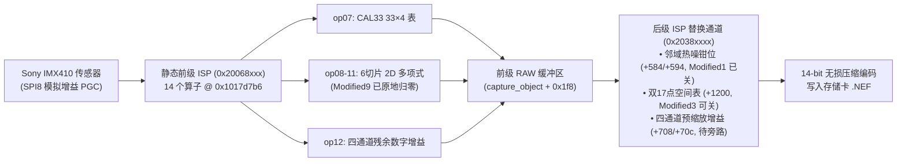

# Nikon Z6 (C3.80) 天文 RAW 固件逆向与实拍阶段报告

> **版本节点**：`Modified9`（实拍样本批次：`11.13_modified9`，机身一代 Z6 + Viltrox 16mm f/1.8 Z）  
> **核心目标**：① 保留真实暗电流与微弱星点 · ② 关闭 NEF 写入前数字 RAW 校正 · ③ 消除平场同心彩圈 · ④ 机械快门零故障稳定运行  
> **报告原则**：所有结论均基于真机实拍 14-bit 无损 NEF 逐像素解算，严格区分**已实机解决项**与**待下一版收敛项**。

---

## 一、当前总览：三大指标实机验收看板

| 攻坚维度 | 原厂 C3.80 痛点 | 当前方案 (`Modified9`) | 真机实拍量化验证结果 | 当前状态 |
| :--- | :--- | :--- | :--- | :---: |
| **1. 暗电流与热像素保留** | 5s 暗场将亮点强行压制到同色八邻域最大值 `+8k DN`，吞噬暗弱星点与真实热噪 | 静态属性构造分支 3 处指令旁路 (`0x100c2654 / 7c / 90`)，关闭 `bank+0x584/+0x594` 邻域钳位 | 112 颗冻结监测热像素钳位率 **`112/112 → 0/112`**；`<1008 DN` 高斯负向噪声保留 **42.9%**，`0 ADU` 硬截断像素 **0 个**；读出噪声保持 **3.536 DN** | **已彻底解决** |
| **2. 静态快门稳定性** | 早期跳过前级算子 (`Modified5/8`) 会使硬件 DMA 缺少描述符，50ms 超时报 `Err` 死锁 | 保留全部 14 个原厂前级算子原生运行，在 `0x1017d834` 硬件分发前挂载 68B 原地纯化函数 (`0x1002d884`) | 连续实拍 9 张（3 平场 + 3 偏置 + 3 张 5s 暗场）快门干脆利落，**0 卡顿、0 `Err`、2.20 亿像素无损解码 0 误差** | **已彻底解决** |
| **3. 平场同心彩圈与预缩放** | 多级空间增益与数字白平衡预缩放叠加定点截断，在拉伸平场中产生同心彩环 | 已在静态前级将 `0x20068718..87d4`（6 切片 54 项 2D 多项式）清零并锁定 1.0 直流增益 | 四角（`r>1.1`）色偏移除约 `1.8%~2.1%`；**但主视场 `σ=6` 高通细环仍在（R/G `0.182%`，与 `Modified4` 相关性 `0.85`），且检出 R/B 直方图缺码梳齿与后端 `NEFInfo 0x7` 复开** | **部分生效 · 下一刀收敛** |

Nikon Z6 天文固件实拍四维验证总览（`analysis/modified9-real-2026-11-13/z6-astro-progress-summary.png`，本地归档未公开）

---

## 二、我们是怎么解决的？（固件逆向与补丁机制）

### 1. 静态 RAW 全链路架构定位

通过对 `eg1620_038000.bi`（33.5 MB 主固件，加载基址 `0x10020000`）的反汇编、Unicorn 原生指令回放、QEMU 联调以及本机 `CAL38.bin` / `ID35.bin`（2.25 MiB 出厂标定备份）解析，完整摸清了 Z6 静态拍照写卡前的双阶段 ISP 流水线：

### 2. 三项关键工程手术（全固件仅改动 83 字节 / 0.00025%）

1. **精准破除“吃星/吃暗场”算法（10 字节代码改动）**  
   - **逆向发现**：在 171 张原厂 NEF 基线比对中，锁定了尼康长曝光暗场的定量数学指纹——所有持续偏亮像素在 5 秒暗场中均被强行压制为：
     $$\text{Centre} = \max_{8\text{ 同色邻域}} + 8k \quad (k \in \{0,1,\dots,7\})$$
   - **修改方式**：追踪 `0x100c24f2 → 0x10196a3c → 0x100d5b9c`，在静态属性生成器的 `0x100c2654`、`0x100c267c`、`0x100c2690` 三处用等效 `MOV.W` 覆盖分类与使能（`props+4c=0, +4e=2, +4f=2`），不动取景与视频分支。

2. **根治快门 `Err` 锁死（50ms DMA Event 8 同步机制）**  
   - **故障根因**：静态捕获主控 `0x10179d7c` 调用前级构建器 `0x1017d7b6` 后，会在 `0x10179da4` 等待硬件 `Event 8`（硬限时 `50ms`）；此前 `Modified8` 直接 `NOP` 掉 `op 08..11`，导致报文槽描述符缺失、DMA 饥饿超时，触发 `0x10179daa: orr r5, r5, #0x20` 进入快门报错重启循环。
   - **安全架构 (`Modified9`)**：让原厂全部 14 个算子（`op 01..14`）100% 原生跑完并填好所有硬件描述符与光学中心（`0x20068718 = 0x37663420`），仅在末尾提交前的 `0x1017d834` 切入对齐空洞 `0x1002d884`（68 字节 Thumb-2 机器码），原地将 `0xc29a3754` 缓冲区内 54 个径向多项式项清零、四色通道直流增益设为 `16384`（`1.000000`），随后尾调用原厂 `0x1011d548(1)` 提交硬件并重算模块 `CRC16-CCITT`（`0x12013678`）。

---

## 三、我们是怎么验证的？（真机样本硬核审计）

对 `samples/11.13_modified9/` 实拍的 9 张样本（平场 `4945–4947`、偏置 `4948–4950`、5 秒暗场 `4951–4953`，均为 ISO 1600、机械快门、机身菜单暗角/失真/衍射与两项降噪全关）执行了四重独立检验：

1. **双独立解码器逐像素校验（防文件损坏/伪造）**  
   使用独立编写的 C++ Nikon 14-bit 无损解码器与开源 `LibRaw` 逐像素比对全部 9 张图像，合计 **`220,487,040` 个像素码值差异为 `0`**。
2. **5 秒暗场 112 点回归检验**  
   原厂 `Z61_4854.NEF` 中 `112/112` 落入 `[0, +56] DN` 邻域钳位带；`Modified9` 三张暗场（`4951–4953`）落入钳位带的点数全部为 **`0 / 112`**，**`112 / 112`** 完整释放真实暗信号（其中 53~64 点自然达到 `16383` 满阱饱和），全画幅净暗流均值 `DARK − BIAS = +1.37 DN`。
3. **偏置场（BIAS）黑电平与读出噪声检验**  
   有效区均值 `1008.20 DN`（原厂黑电平 `1008 DN`），低于 `1008 DN` 的左半侧高斯读出噪声像素占比 **42.9%**（逾 1050 万像素），`0 ADU` 截断像素 **0 个**；双帧差分中心 68% 读出噪声 **`central68/√2 = 3.536 DN`**，与原厂 C3.80（`3.536 DN`）完全一致，无列条纹或行横纹伪影。
4. **平场彩圈诚实复核与直方图梳齿新发现（关键纠偏！）**  
   - 用统一 `16×16` 原始 CFA 浮点分箱法（不去马赛克、不套镜头校正）与前序固件同口径对比发现：**此前初审脚本因未与 `Modified4` 横向对齐，误判了细环消除**。真实数据如下：

| 固件版本 | 宽径向起伏 R/G (`0.15~0.90`) | 宽径向起伏 B/G (`0.15~0.90`) | `σ=6` 高通细环 R/G | `σ=6` 高通细环 B/G | MakerNote `NEFInfo 0x7` 后端空间表 |
| :--- | :---: | :---: | :---: | :---: | :---: |
| `Modified4` (`4910–4911`) | 1.228% | 1.612% | 0.193% | 0.136% | 已关闭 (`active=0`) |
| `Modified6` (`4917, 4921`) | 1.525% | 1.412% | 0.184% | 0.138% | 已关闭 (`active=0`) |
| `Modified7` (`4928–4931`) | 1.408% | 1.550% | 0.220% | 0.147% | 已关闭 (`active=0`) |
| **`Modified9` (`4945–4947`)** | **1.464%** | **1.431%** | **0.182%** (`r=0.85`) | **0.156%** (`r=0.84`) | **重新激活 (`active=1`)** |

   - **两项决定性新发现**：
     1. **曝光变化对照证明细环锁定在空间半径 `r`**：对比曝光亮度相差 `+26%` 的 `4945` 与 `4946`，高通细环按**空间半径**对齐相关系数达 **`+0.82`**，而按信号 DN 对齐仅 `+0.33`；同时因 `Modified9` 剥离了 `Modified2/3` 补丁，即便机身菜单关闭暗角控制，后端 `NEFInfo 0x7` 双 17 点空间表（`[142, -79, 0, -74, -6, 61]`）仍在电子镜头下自动激活！
     2. **ADU 直方图 FFT 抓到残留数字乘数“梳齿”**：在 `4945` 中心 `400×400` 区域内，R 通道每隔约 `4.38 ADU` 出现周期性缺码谷值（梳齿频率 `f = 0.228 cycles/ADU`, SNR=19.7），B 通道同时出现缺码与并码双峰（`f = 0.210 cycles/ADU`），证明 **NEF 落盘前仍有数字增益乘法器在运行**（位于后端 `0x20380708` 预缩放通道及前级 `0x200687e8` 残余数字增益）。

---

## 四、下一步最终收敛方向（迈向 `Modified10`）

当前我们已经彻底稳住了**暗电流无损保留**与**零 `Err` 静态前级钩子框架**，并把残留彩圈与缺码梳齿精准锁定在最后两道关卡：

1. **打通全画幅前端 RAW 直通（`0x100ae3a4: still-preserve-fullsize-raw`）或合入 `Modified2/3` 后端空间表归零**：直接让全尺寸静态 NEF 编码器读取前级缓冲区 `capture_object+0x1f8`，一举绕过整个 `0x20380000` 后级 ISP 替换通道（含后端四通道数字预缩放 `+708/+70c` 与双 17 点空间表 `+1200/+1224`）。
2. **核查前级残余四通道数字缩放（`0x1011e940 → 0x200687e8..87ec`）与 `CAL33` 表体**：在离线 Unicorn 回放中确认单位增益闭合后，再做下一次单步受控实拍验证。
